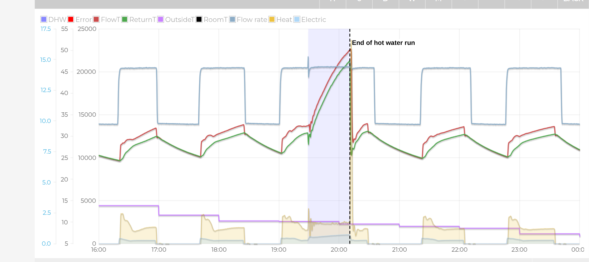
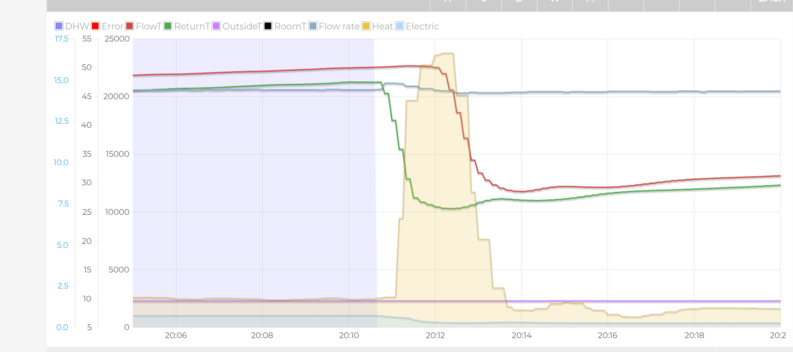
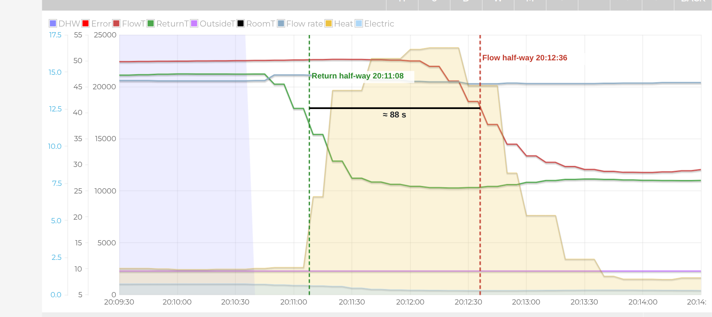
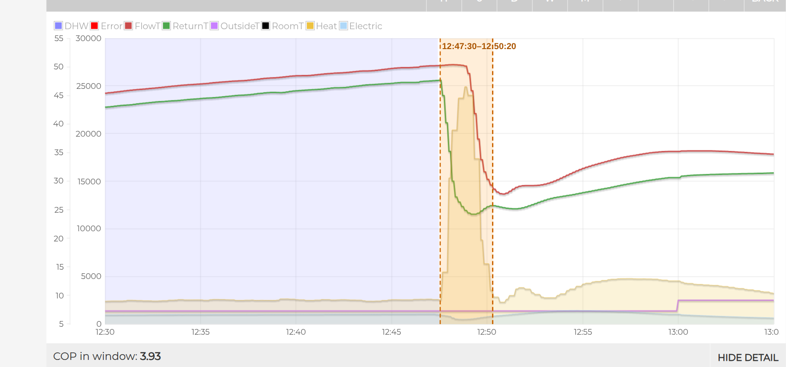
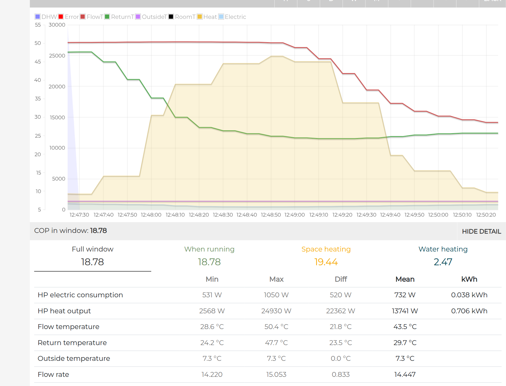
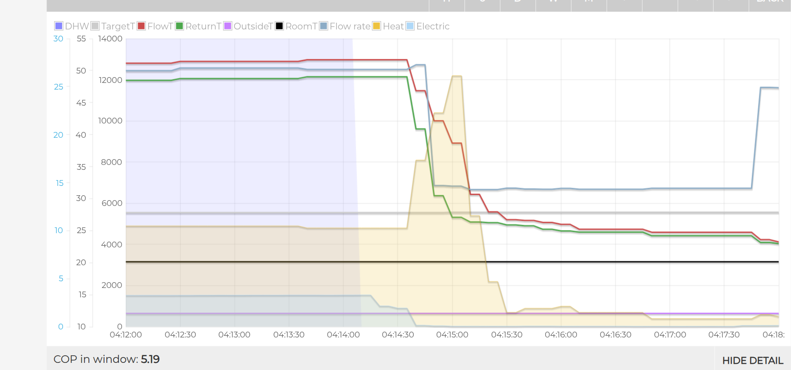
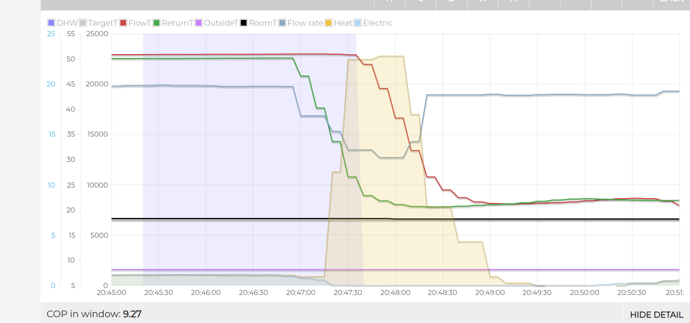
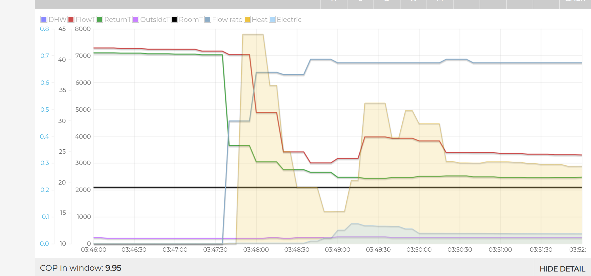
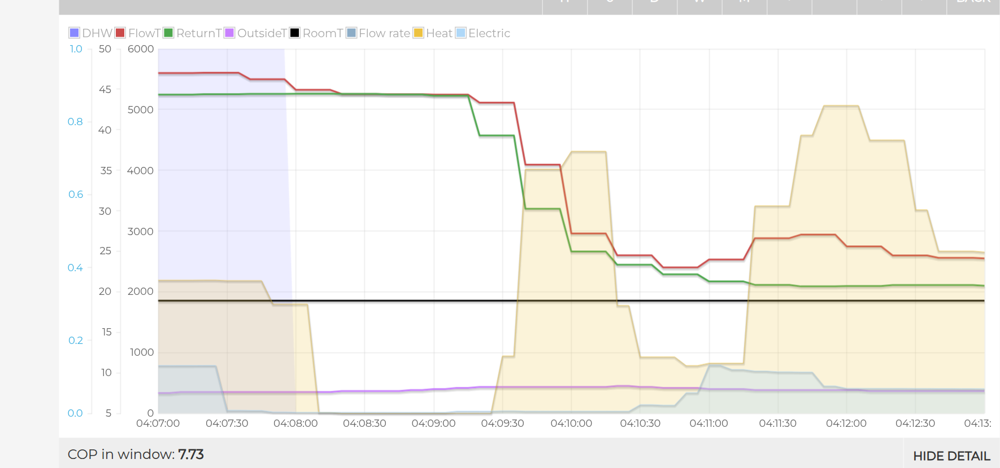

# Measuring primary pipework length from the dashboard

This guide shows how to estimate the volume and length of the primary pipework between a heat meter and the heat pump using only the HeatpumpMonitor.org dashboard.
The example is system 384 (Vaillant Arotherm+ 5 kW, 28 mm copper primaries).

## The idea

The heat meter has two temperature sensors: one on the return pipe going out to the heat pump and one on the flow pipe coming back.
Water passing the return sensor has to travel to the heat pump, through it, and back to the flow sensor.
If the return temperature changes suddenly, the flow temperature shows the same change a little later.

That delay times the flow rate is the volume of water between the two sensors:

```
volume (L) = delay (s) × flow rate (l/min) / 60
```

Take off the water inside the heat pump, divide by the volume per metre of the pipe, and halve it to get the length each way.

## 1. Find a sharp change in return temperature

The clearest event is the end of a hot water run.
During hot water heating the return comes back from the cylinder coil at 45–50 °C.
When the diverter valve switches back to space heating, the return drops to about 25 °C within a minute.
The heat pump doesn't have time to follow, so the same drop reaches the flow sensor one loop delay later.

Open the system's dashboard in power view for a day with a hot water run.
Hot water periods are shaded purple.



*System 384 on 16 Oct 2026. The return (green) and flow (red) both fall sharply at 20:10 when hot water heating ends.*

You can go straight to a time window with a URL like this (start and end are unix timestamps in seconds):

```
https://heatpumpmonitor.org/dashboard?id=384&mode=power&start=1792177500&end=1792178400&flow=1
```

`flow=1` turns on the flow rate line.

## 2. Zoom in

Use the + button or a shorter URL window to zoom to about 15 minutes around the switch.
The return drops first and the flow follows about a minute and a half later.



*20:05–20:20. Green (return) drops at about 20:11, red (flow) at about 20:12:30.*

The big yellow spike in heat output is a side effect of the same delay.
For those 90 seconds the meter sees hot water on the flow sensor and cold water on the return sensor and calculates a ΔT of over 20 K.
The energy in that spike gives a second way to get the volume, described [below](#second-method-heat-in-the-spike).

Zoom in again to a window of about 5 minutes.
At windows under about 3 hours the dashboard shows the full 10 s data, and at 5 minutes the time axis is labelled every 30 seconds.



*20:09:30–20:14:30. Dashed lines mark where each temperature is half-way through its drop.*

## 3. Read off the delay

Both sensors smooth the step a little, so compare the same point on each curve rather than where each one starts to move.
The half-way point works well:

| | Before | After | Half-way | Time |
|---|---|---|---|---|
| Return | 47.4 °C | 25.5 °C | 36.5 °C | 20:11:08 |
| Flow | 50.3 °C | 28.5 °C | 39.4 °C | 20:12:36 |

The delay is 20:12:36 − 20:11:08 = **88 s**.

The tooltip only shows hours and minutes, so read the time from the axis gridlines.
With 10 s data you can read it to about ±10 s.
If you want exact times, the same data is available as JSON from the API, with unix timestamps:

```
https://heatpumpmonitor.org/timeseries/data?id=384&feeds=heatpump_flowT,heatpump_returnT,heatpump_flowrate&start=1792177770&end=1792178070&interval=10&average=0&timeformat=unix
```

## 4. Read the flow rate

Read the flow rate from the blue line (left-hand axis, l/min) or from the table under the graph.
For system 384 it is 14.4 l/min.

## 5. Work out volume and length

```
volume = 88 s × 14.4 l/min / 60 = 21.1 L
```

This is all the water between the two sensors: flow and return pipes, the heat pump's own water content, and any fittings or strainers.
The water content of a 5 kW Arotherm+ is about 2 L (check the datasheet for your model), which leaves about 19 L in the pipes.

Volume per metre of copper pipe:

| Pipe | Bore | Litres per metre |
|---|---|---|
| 22 mm copper | 20.2 mm | 0.32 |
| 28 mm copper | 26.2 mm | 0.54 |
| 35 mm copper | 32.6 mm | 0.83 |

```
pipe length = 19.1 L / 0.54 L/m = 35 m
each way    = 35 m / 2 = about 18 m
```

## Checking the result

Three hot water switch-overs that week gave 87, 88 and 88 s, all about 21 L.
The automated analysis (cross-correlating flow and return over a whole week) gave 90 s for hot water and 80 s for space heating, which is 21.5 L and 19.1 L.
The 16 m figure in the earlier report comes from the 80 s space heating value.
Taken together the primaries are 16–18 m each way between the meter and the heat pump.

## Second method: heat in the spike

When the hot water run ends, the water between the two sensors is still at hot water temperature.
The pump pushes it out into the house and replaces it with cold return water.
The heat meter counts the heat in that hot water as it leaves, which is the spike.
So the energy in the spike is the heat stored in the loop water:

```
spike energy = volume × cp × ΔT
volume       = spike energy / (cp × ΔT)
```

ΔT is the size of the temperature step, and cp is the heat capacity of water per litre.
At 40–50 °C that is 4.13 kJ/L/K (4.18 kJ/kg/K × 0.99 kg/L).
This method doesn't need the flow rate or any times read to the second.

It gives the same answer as the timing method.
If the flow temperature is the return temperature delayed by τ seconds plus a steady lift from the heat pump, the area of the spike above that lift is ΔT × τ, whatever the shape of the step.
Multiplying by flow rate and heat capacity gives volume × cp × ΔT.

### 1. Select the spike

This example is a hot water run that ended at 12:47 on 14 Nov 2026.
Set the window so it starts just before the return starts to fall and ends once the flow has finished falling.



*12:30–13:05. The shaded window covers the spike.*

```
https://heatpumpmonitor.org/dashboard?id=384&mode=power&start=1794660445&end=1794660625
```

### 2. Read the numbers from the table



*12:47:25–12:50:25 (180 s).*

The table under the graph gives everything you need:

| | Reading |
|---|---|
| Heat output in window | 0.706 kWh |
| Heat output before the switch (the Min heat value) | 2568 W |
| Return temperature drop (the Diff return value, 47.7 − 24.2) | 23.5 K |

### 3. Take off the baseline

The compressor keeps running through the spike.
Its own output, about 2.6 kW, isn't part of the spike:

```
baseline = 2.6 kW × 180 s / 3600 = 0.130 kWh
spike    = 0.706 − 0.130 = 0.576 kWh = 2074 kJ
```

### 4. Work out the volume

```
volume = 2074 kJ / (4.13 kJ/L/K × 23.5 K) = 21.4 L
```

The timing method on the same event gives 88 s × 14.4 l/min = 21 L.
From here the pipe length works out as in step 5 above.

### Things to watch

- **Baseline.** The compressor ramps down during the spike (1080 → 530 W), so its output isn't quite constant. An error of 0.5 kW changes the volume by about 4%.
- **ΔT.** Use the size of the return step, or the flow step if the window covers the whole flow drop. Don't use the change in mean water temperature. Each 1 K error changes the volume by about 4%.
- **End of the window.** End it once the flow has stopped falling. A longer window picks up heat from the system recovering: on this event a 250 s window gives 21.6 L and a 350 s window 22.3 L.
- **Water inside the heat pump.** As with the timing method, the result includes the heat pump's own water content.

## Other systems

The same two methods were tried on three more systems.
Two of them have a known meter position, which checks the methods against reality.

| System | Heat pump | Pipe | Delay | Timing | Spike | Known |
|---|---|---|---|---|---|---|
| 384 | Vaillant Arotherm+ 5 kW | 28 mm | 88 s | 21 L | 21.4 L | |
| 748 | Grant Aerona HP290 | | 13–14 s | 4.1 L | 4.3 L | meter about 0.5 m from the heat pump |
| 1088 | Grant Aerona HP290 6.5 kW | 28 mm | 46 s | 10.5 L | 11.8 L | |
| 2 (2025) | Mitsubishi Ecodan 5 kW | 22 mm | about 18 s | 2.8 L | 4.2 L | |
| 2 (2026) | Mitsubishi Ecodan 5 kW | 22 mm | about 9 s | 1.8 L | 2.3 L | meter moved 2.1 m closer, which is 1.34 L |

The figures are medians over all the clean events in one week.

### 748: short loop, compressor stops



*27 Oct 2026, 04:12–04:18 GMT.*

On this Grant the compressor stops when the hot water run ends, and the flow rate falls from 27 to 14.5 l/min during the step.
The flow follows the return about 13 s later, which is only one or two samples.

Because the flow rate changes, add up the flow over the delay rather than multiplying by one flow rate.
In practice, use the average flow rate between the two half-way points.

For the spike, take off the heat pump's own output (its lift of about 2.7 K) only while the compressor is still running.
After it stops there is no baseline, although some heat stored in the heat exchanger still comes out, so the spike reads slightly high.

About 4 L between the sensors with the meter 0.5 m away means most of it is water inside the heat pump and the meter.
That is useful when working out pipe length for other Grant systems.

```
https://heatpumpmonitor.org/dashboard?id=748&mode=power&start=1793074320&end=1793074680
```

### 1088: medium loop



*11 Mar 2026, 20:45–20:51 GMT.*

This is the same model of heat pump, also with the compressor stopping at the switch.
Seven events that week gave 44–47 s and 9.8–11.6 L, so the result is very repeatable.

With 28 mm pipe, and taking off about 3.5 L for the heat pump and meter (from 748), the pipe holds about 7 L.
That is about 13 m of pipe, or 6.5 m each way.

The hot water flag on this system is only logged when it changes, so on the dashboard look for the large return drops rather than the purple shading.

```
https://heatpumpmonitor.org/dashboard?id=1088&mode=power&start=1773261900&end=1773262260
```

### System 2: pump stops after hot water

On this Ecodan both the compressor and the pump stop at the end of a hot water run, so there is no step while the pump runs.
Two other events work instead:

- **The pump restarting** for space heating a minute or so later. The water left in the loop is still at hot water temperature, and the pump flushes it out with 20 °C water from the house before the compressor starts.
- **The start of a scheduled hot water run** while space heating is on. The diverter switches to the cold cylinder coil and the return drops 6–10 K.

The pump restart is the better one for the spike method.
By then the heat pump has stood for a minute, so there is no stored heat in the heat exchanger to add to the spike.
At the start of a hot water run the compressor has only just stopped, and the spike reads about twice the true volume.

Only use a pump restart if the flow and return were at about the same temperature before it.
If the flow side is still hotter than the return side, the loop water isn't at one temperature and there is no single ΔT for the step.

This meter updates its temperatures only every 20 s, and at 11.6 l/min that is 3.9 L per update.
The timing method can't resolve much less than that, so the spike method is the better one here.



*Before the meter was moved: 10 Nov 2025, 03:46–03:52 GMT. The flow rate (blue, outer left-hand axis) is in m³/h.*



*After the meter was moved: 10 Nov 2026, 04:07–04:13 GMT. There is no flow rate feed after May 2026.*

The meter was moved 2.1 m closer to the outdoor unit in May 2026, which takes out 4.2 m of 22 mm pipe, or 1.34 L.

| Method | Before | After | Difference | Each way |
|---|---|---|---|---|
| Spike | 4.2 L | 2.3 L | 1.9 L | 3.0 m |
| Timing | 2.8 L | 1.8 L | 1.0 L | 1.5 m |
| Actual | | | 1.34 L | 2.1 m |

Both methods are within about 0.6 L of the actual change, and their average (2.3 m each way) is close to it.
The heat pump's own water is in both measurements, so it cancels out of the difference.

Without a flow rate feed, the flow rate can be worked out from steady running as heat ÷ (cp × ΔT).
Here 5.54 kW at a 6.7 K ΔT gives 12 l/min, which matches the 11.65 l/min the flow meter measured in 2025.
The spike method doesn't need a flow rate at all.

## Tips and limits

- Any sharp change in return temperature will do: the end of a hot water run, the pump restarting after a hot water run, the start of a hot water run, a zone valve closing, or a bump in return temperature while the pump runs with the compressor off.
  The end of a hot water run is the easiest when the pump keeps running, because the step is large.
- If the flow rate changes across the event, use the average flow rate between the two half-way points.
- If the meter updates less often than every 10 s, the timing method gets coarser. Use the spike method.
- Overall the methods agree with known meter positions to about ±1 L. That is about ±1 m each way of 28 mm pipe or ±1.5 m of 22 mm.
- One 10 s sample is 2.4 L at 14.4 l/min, or about 2 m each way of 28 mm pipe.
  Repeat on two or three events and take the middle value.
- The method measures volume, not length. The length depends on the pipe bore you assume, and any buffer, low loss header or plate heat exchanger between the sensors adds volume.
- The same method with the flow sensor first and the return sensor second gives the delay round the house side. That is much longer and less sharp because the water mixes in the emitters.
