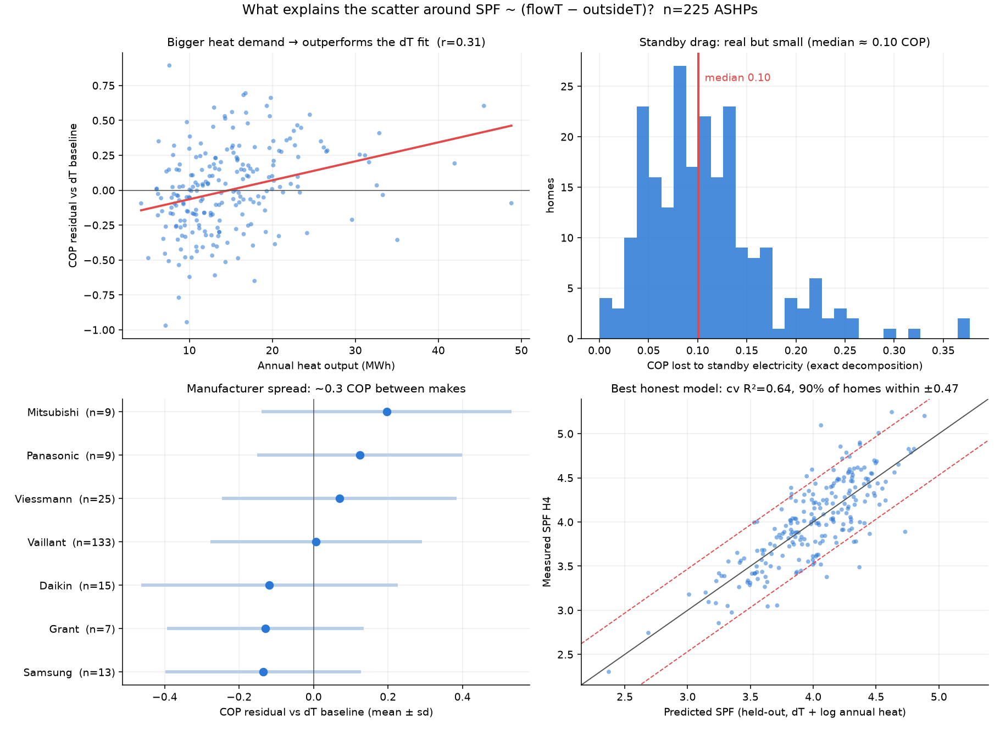
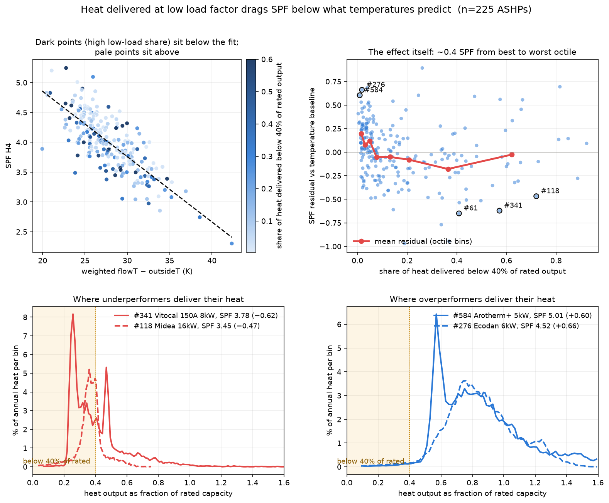

# Heat pump performance prediction

---

*Note from Trystan: This performance prediction project was largely generated using Claude code (Model: Fable - effort high).
Apart from this brief introduction the document text is all written by claude as will be clear!*

*This analysis attempts to progress my earlier manual analysis of the HeatpumpMonitor.org dataset as documented here: [https://docs.openenergymonitor.org/heatpumpmonitor/index.html](https://docs.openenergymonitor.org/heatpumpmonitor/index.html). I think it has uncovered a number of useful ideas!*

*The analysis also develops a harness for the dynamic heat pump simulator tool that I have been working on here: [https://openenergymonitor.org/tools/dynamic_heatpump](https://openenergymonitor.org/tools/dynamic_heatpump) and uses this to test and refine ideas that could then be applied to the real world data set. More work needs to be done to verify if these ideas work when applied to real data!*

*The following is work in progress and I welcome suggestions for improvement!*

---

**The question:** how well can we predict a heat pump's seasonal
performance (SPF H4) from what we know about the system? The starting point
is the known link between SPF and weighted flow temperature minus outside
temperature (ΔT), which predicts SPF to about ±0.5. The goal was ±0.1.

**The answer so far:** ΔT is still the best predictor. Adding annual heat
demand helps a little. Nothing else tried beats it on the real fleet.

| Predictor | cv R² | 90% interval | |
|---|---|---|---|
| Weighted ΔT | 0.59 | ±0.50 | the baseline |
| ΔT + log annual heat | 0.64 | ±0.47 | best found |
| H\* metric | 0.47 | ±0.58 | worse than ΔT (n = 229) |
| Design sheet model | 0.08 | ±0.74 | limited by its inputs |
| Metering error alone | | ±0.10 | the floor |

All scores are cross-validated on held-out systems. In the October
simulator sweeps H\* beats ΔT, but that didn't carry over to real systems.

**Data:** the HeatpumpMonitor.org export of 2026-07-15, filtered to 225 air
source, MID-metered, H4 systems with at least 330 days of data and no
cooling. Section 4 also uses the raw 10 s feeds of 229 systems.

**Other docs in this folder:**

- [metering_floor.md](metering_floor.md): how accurate a measured SPF is
- [design_model.md](design_model.md): predicting SPF from the design sheet
- [load_and_quality.md](load_and_quality.md): why the simulator's load
  effect doesn't show up in real Arotherms, and the experiment to test it
- [machine_replay.md](machine_replay.md): real Arotherm+ data replayed
  through the datasheet
- [daily_records.md](daily_records.md): using daily data, and projecting
  annual SPF from the first few weeks
- [mcs_and_scop_methods.md](mcs_and_scop_methods.md): manufacturer SCOP and
  MCS 031 estimates against measured SPF

## 1. The baseline still holds

On current data the fit is **SPF = −0.110·ΔT + 7.04** (R² 0.60), close to
the published −0.105·ΔT + 6.88 (R² 0.55). Curved fits (quadratic, log-log,
Carnot) don't do better. The limit is how much one averaged ΔT can tell
you, not the shape of the line.

The no-cooling filter matters. Without it the fit weakens (n = 258,
R² 0.46) because the published stats count summer cooling as heat.

Filter counts: H4 boundary 268 → air source 263 → no cooling 228 →
≥330 days 226 → COP and ΔT present 225.


## 2. What the published stats add

| Field | Effect | Worth adding? |
|---|---|---|
| Annual heat demand | bigger homes beat the line (ρ = 0.36) | **yes**, the only useful addition |
| Standby electricity | costs a median 0.10 COP, worst 0.38 | no, nothing once annual heat is in |
| Utilisation | cv R² 0.62 | no, it only works through annual heat |
| Mean load while running | ρ = 0.19 | no |
| Make | Mitsubishi ~0.2 above, Samsung/Grant/Daikin ~0.13 below | no, too much spread within each make |
| Weather comp. with room influence | 11 systems, 0.22 below | no improvement in cv R² |
| Emitters, DHW control, DHW target, refrigerant | | no |

The best model:

```
SPF = 6.53 − 0.114·ΔT + 0.25·ln(annual heat, MWh)
```

Doubling annual heat is worth about +0.17 SPF. It's unclear why. Bigger
homes have less standby share, steadier running, and probably smaller
pipework losses in proportion, and annual data can't separate these.

Standby can be removed exactly:
`combined_cop = running_cop / (1 + standby_elec / running_elec)`.

Bigger models don't help. A linear model with every safe field scores
cv R² 0.61, and gradient boosting 0.55. With 225 systems they overfit.
Getting to ±0.25 would need R² ≈ 0.90, and ±0.10 would need 0.98. That
needs better inputs, not better models.

**Watch out for leakage.** An early model scored a fake cv R² of 0.85
because it could rebuild COP from heat and electricity fields. Never give a
model both. `prc_carnot`, `water_cop`, `running_cop` and the unit cost
fields are all COP in disguise.



## 3. Systems running at low load do worse

From the power histograms in the heatpumpmonitor.org API: the more heat a
system delivers **below 40% of its rated output**, the worse it does
against the ΔT line (ρ = −0.33). This still holds after allowing for
annual demand (−0.28).

Most systems deliver about 10% of their heat at low load. The top 15%
deliver 40–72%, and sit about 0.23 COP below the rest. This looks like
oversizing: below minimum modulation the machine cycles, and fixed losses
weigh more.

It's a weak signal in a regression, though (p = 0.11 on top of ΔT and
annual heat, no cv R² gain). What causes it is still open, see
[load_and_quality.md](load_and_quality.md). Electricity histograms showed
nothing useful.



These figures use the July 2026 histograms in `modulation_features.csv`. An
October re-fetch changed two systems, moving ρ to −0.35.

## 4. The simulator and H\*

`sweep.js` runs the dynamic_heatpump simulator over 400 random house
and system designs, and drops those that fail on comfort. It lives in the
[tools repo](https://github.com/openenergymonitor/tools), branch
`dynamic-heatpump-sweep`. The October 2026 sweeps (tools commit `e522457`,
files `sim_carnot_2026-10.csv` and `sim_arotherm_2026-10.csv`) include
defrost, pipework losses, a cylinder model and emitters sized for
35–55 °C. The same 400 houses were run with a Carnot machine and with
Arotherm+ datasheet models, with DHW matched to the fleet's 14% share.

**Identical machines still scatter.** The simulated fleets scatter ±0.34 to
±0.40 around their own ΔT line, with no differences in machines, installs
or metering. Real machines don't follow their COP model exactly, so this
shows how much operating pattern *could* matter, not how much it does.

**H\*** is a heat-weighted harmonic mean of Carnot COP, with the
temperature lift widening as load rises. It needs no electricity data.

```
r      = heat / rated capacity            (load ratio)
Tcond  = flowT    + 3·r
Tevap  = outsideT − 8·r
carnot = (Tcond + 273.15) / (Tcond − Tevap)

H* = Σ heat / Σ (heat / carnot)           (running samples only)
```

It beats ΔT in both October sweeps, but is the worst of the three on
the real fleet (computed from raw feeds by `scripts/feed_scan/hstar_fleet.php`).
Cross-validated R², ±90% interval:

| SPF against | Oct sim, Carnot | Oct sim, Arotherm+ | Real fleet |
|---|---|---|---|
| Weighted ΔT | 0.61, ±0.40 | 0.77, ±0.34 | 0.59, ±0.50 |
| Carnot, fixed +2/−6 | 0.63, ±0.40 | 0.78, ±0.32 | 0.57, ±0.52 |
| H\* (+3r/−8r) | 0.72, ±0.33 | 0.87, ±0.25 | 0.47, ±0.58 |

To check it wasn't just the wrong coefficients, 1,092 combinations were
tried on the real fleet. **The best load coefficient is zero**, and none
beat plain ΔT. That closes the metric search. The likely reason: the
Arotherm+ datasheet predicts a strong load effect that real Arotherms
don't show (see [load_and_quality.md](load_and_quality.md)).

Side results:

- **The two pipelines agree.** The raw feed scan matches the published
  stats to a few hundredths of a K for about 90% of systems. Most of the 25
  that don't are cooling systems: the published pipeline counts cooling as
  heat, the scan leaves it out. A few have poor outside temperature data.
- **Badge capacity is a poor guide.** Observed peak output is a median
  1.33× the badge (IQR 1.09–1.67). Some 5 kW systems show 26–49 kW peaks,
  which must be heat meter spikes.
- **Ground source is excluded.** H\* assumes the evaporator sees outside
  air.

## 5. Ideas not yet tried

- **Daily records.** About 80,000 system-days instead of 225 annual
  points. A pooled model of daily COP with a per-system offset is the most
  promising ML route. The target would be ±0.25 on held-out annual SPF.
- **Model the residual.** A small regularised model on top of the ΔT fit,
  with SHAP values to explain each system's gap.
- **Fit the simulator to each home.** The fitted % of Carnot becomes a
  cleaner machine quality score. The Arotherm twins in
  [load_and_quality.md](load_and_quality.md) are a first step.
- **New metadata:** glycol concentration, primary pipework length, and the
  commissioned weather compensation curve.
- **Publish a standby-corrected SPF.** It's an exact calculation.
- **Installer as a category.** Probably more useful than make, but most
  installers have only a few systems.
- **Defrost exposure from weather data.** Humidity and frost hours by
  location.

## Data notes

Traps in the all-fields export:

- `weighted_average_flow_minus_outside` and `weighted_flow_temp` are old
  sparse fields with 0 for missing. Use `weighted_flowT_minus_outsideT` and
  `weighted_flowT`.
- `heat_loss` is mostly kW but some values are in W. Divide values over 100
  by 1000 and drop anything under 0.5 kW.
- `measured_heat_loss`, `dhw_target_temperature`, `flow_temp`,
  `hp_max_output` and `measured_mean_flow_temp_coldest_day` use 0 for
  missing.
- About 10% of systems report zero `water_heat_kwh`, probably unmetered.
- Logging periods vary (330–365 days), so annualise kWh before comparing.

The histogram API needs a non-default User-Agent (`Python-urllib` gets a
403):

```
https://heatpumpmonitor.org/histogram/kwh_at_power_heat?id=<id>&start=<t>&end=<t>&x_min=0&x_max=30000
```

## Running the scripts

From `analysis/performance_prediction/`:

```
python3 -m venv .venv
.venv/bin/pip install -r requirements.txt
.venv/bin/python scripts/<name>.py
```

Scripts find their data relative to themselves and use the newest
`heatpumpmonitor_all_fields_*.csv`. Figures go to `docs/figures/`.

| Path | What it is |
|---|---|
| `scripts/hpmon_analysis.py` | loader, standard filter, linear fit (section 1) |
| `scripts/residual_analysis.py`, `residual_plots.py` | residual tests and CV harness (section 2) |
| `scripts/regression_analysis.py` | utilisation, install and control fields, coldest-day model (section 2, design_model.md) |
| `scripts/fetch_histograms.py`, `modulation_analysis.py`, `lowload_plots.py` | low-load features (section 3). Run `fetch_histograms.py` first; the `histograms/` cache isn't in git |
| `scripts/analyse_hstar_fleet.py`, `analyse_hstar_offsets.py` | H\* fleet test and coefficient search (section 4) |
| `scripts/hstar_plots.py` | figures for load_and_quality.md; needs `hstar_hist.csv` |
| `scripts/sim_model_comparison.py` | October sweeps against the fleet (section 4, load_and_quality.md) |
| `scripts/design_model.py` | design sheet model |
| `twins/` | Arotherm+ datasheet twins: `twin_targets.py` builds targets, `twins.js` runs them (tools repo `176ae57` or later), `compare_twins.py` compares with real systems |
| `design_spf_tool/index.html` | interactive design sheet model |
| `heatpumpmonitor_all_fields_*.csv` | fleet export |
| `modulation_features.csv` | low-load features, July 2026 |
| `hstar_fleet.csv`, `hstar_fleet_hist.csv` | raw feed scan results, one row per system |
| `hstar_hist.csv` | per-system heat histograms, 113 MB, not in git; regenerate with `hstar_hist_fleet.php` |
| `sim_carnot_2026-10.csv`, `sim_arotherm_2026-10.csv` | October 2026 sweeps |
| `llanberis2024.csv` | the simulator's weather year (copied from the tools repo) |
| `scripts/feed_scan/` (repo root) | PHP feed scanners |
