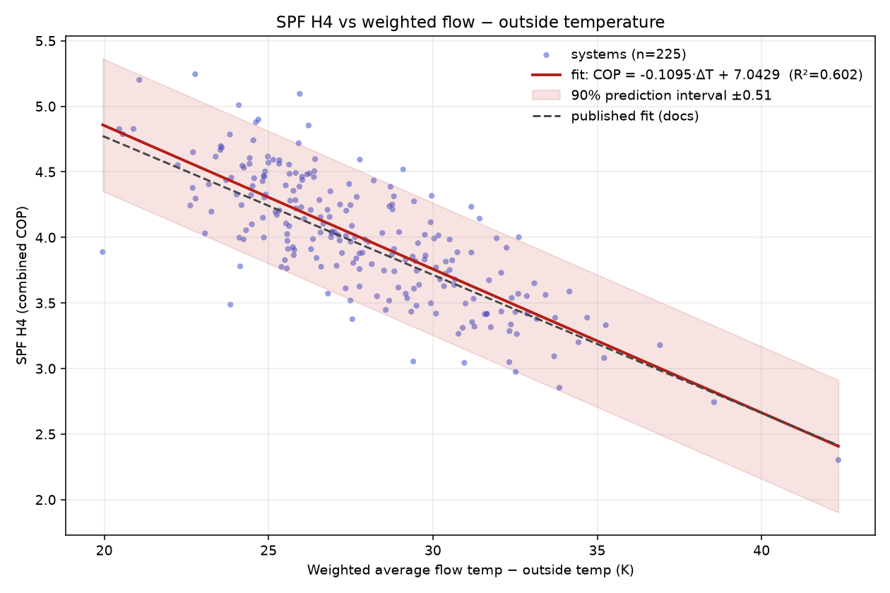

# Heat pump performance prediction

---

*Note from Trystan: This performance prediction project was largely generated using Claude code (Model: Fable - effort high).
Apart from this brief introduction the document text is all written by claude as will be clear!*

*This analysis attempts to progress my earlier manual analysis of the HeatpumpMonitor.org dataset as documented here: [https://docs.openenergymonitor.org/heatpumpmonitor/index.html](https://docs.openenergymonitor.org/heatpumpmonitor/index.html). I think it has uncovered a number of useful ideas!*

*The analysis also develops a harness for the dynamic heat pump simulator tool that I have been working on here: [https://openenergymonitor.org/tools/dynamic_heatpump](https://openenergymonitor.org/tools/dynamic_heatpump) and uses this to test and refine ideas that could then be applied to the real world data set. More work needs to be done to verify if these ideas work when applied to real data!*

*The following is work in progress and I welcome suggestions for improvement!*

---

**The question:** Can we predict a heat pump's seasonal performance (SPF H4) to within ±0.1, starting from the known link with weighted flow-minus-outside temperature (ΔT), which gets you about ±0.5?

**The answer so far:** ΔT is still the best predictor. Adding annual heat
demand helps a little. Nothing else tried beats it on the real fleet.

| Predictor | cv R² | 90% interval | |
|---|---|---|---|
| Weighted ΔT | 0.59 | ±0.50 | the baseline |
| ΔT + log annual heat | 0.64 | ±0.47 | best found |
| H\* metric | 0.47 | ±0.58 | worse than ΔT (n = 229) |
| Design sheet model | 0.08 | ±0.74 | limited by its inputs |
| Metering error alone | | ±0.10 | the floor |

All scores are cross-validated on held-out systems. In the October
simulator sweeps H\* beats ΔT, but that didn't carry over to real systems.

**Data:** the HeatpumpMonitor.org export of 2026-07-15, filtered to 225 air
source, MID-metered, H4 systems with at least 330 days of data and no
cooling. Section 4 also uses the raw 10 s feeds of 229 systems.

**Scripts** run from `analysis/performance_prediction/` in a virtualenv
(`python3 -m venv .venv && .venv/bin/pip install -r requirements.txt`).
They use the newest `heatpumpmonitor_all_fields_*.csv` in that folder and
write figures to `docs/figures/`. Each section below says which scripts
produce its results.

**Other docs in this folder:**

- [metering_floor.md](metering_floor.md): how accurate a measured SPF is
- [design_model.md](design_model.md): an attempt at a simple steady-state design model
- [load_and_quality.md](load_and_quality.md): why the simulator's load
  effect doesn't show up in real Arotherms, and the experiment to test it
- [machine_replay.md](machine_replay.md): real Arotherm+ data replayed
  through the datasheet
- [daily_records.md](daily_records.md): using daily data, and projecting
  annual SPF from the first few weeks
- [mcs_and_scop_methods.md](mcs_and_scop_methods.md): manufacturer SCOP and
  MCS 031 estimates against measured SPF

## 1. ΔT is still the best predictor, and the goal is far off

- On current data the fit is **SPF = −0.110·ΔT + 7.04** (R² 0.60), close
  to the published −0.105·ΔT + 6.88 (R² 0.55).
- Curved fits (quadratic, log-log, Carnot) are no better. The limit is how
  much one averaged ΔT can tell you, not the shape of the line.
- Getting to ±0.25 would need R² ≈ 0.90, and ±0.10 would need 0.98.
  Metering error alone is about ±0.10 (see
  [metering_floor.md](metering_floor.md)), so ±0.1 is roughly the
  measurement floor.

Filter counts: H4 boundary 268 → air source 263 → no cooling 228 →
≥330 days 226 → COP and ΔT present 225. The no-cooling filter matters:
without it R² falls to 0.46 (n = 258), because the published stats count
summer cooling as heat.



*Scripts:* `.venv/bin/python scripts/hpmon_analysis.py` loads the export,
applies the standard filter, fits the line and draws the figure. The other
scripts import their loader and filter from it.

## 2. Annual heat demand is the only extra field that helps

| Field | Effect | Worth adding? |
|---|---|---|
| Annual heat demand | bigger homes beat the line (ρ = 0.36) | **yes**, the only useful addition |
| Standby electricity | costs a median 0.10 COP, worst 0.38 | no, nothing once annual heat is in |
| Utilisation | cv R² 0.62 | no, it only works through annual heat |
| Mean load while running | ρ = 0.19 | no |
| Make | Mitsubishi ~0.2 above, Samsung/Grant/Daikin ~0.13 below | no, too much spread within each make |
| Weather comp. with room influence | 11 systems, 0.22 below | no improvement in cv R² |
| Emitters, DHW control, DHW target, refrigerant | | no |

The best model:

```
SPF = 6.53 − 0.114·ΔT + 0.25·ln(annual heat, MWh)      cv R² 0.64, ±0.47
```

- Doubling annual heat is worth about +0.17 SPF. Annual data can't say
  why. Lower standby share, steadier running and smaller pipework losses in
  proportion are all candidates.
- Bigger models overfit with 225 systems: a linear model with every safe
  field scores cv R² 0.61, and gradient boosting 0.55. The bottleneck is
  better inputs, not better models.

Standby can be removed exactly:
`combined_cop = running_cop / (1 + standby_elec / running_elec)`.


*Scripts:* `scripts/residual_analysis.py` runs the residual tests and holds
the cross-validation harness, `scripts/residual_plots.py` draws the figure,
and `scripts/regression_analysis.py` covers utilisation and the install and
control fields.

## 3. Low-load running: unclear, needs repeating

*Status: provisional. The numbers below come from a quick check of the
July 2026 features file, not from a script, and earlier versions of this
section drew conclusions that didn't hold up. Treat them as leads to
re-test, not results.*

The power histograms in the heatpumpmonitor.org API give the share of each
system's heat delivered **below 40% of its rated output**. An early
analysis read this as "the more low-load heat, the worse the system does".
A closer look doesn't support that. Across the fleet it looks more like a
step than a trend:

| Share of heat below 40% of rated | n | Mean residual from the ΔT line |
|---|---|---|
| 0–6% | 84 | +0.08 to +0.20 |
| 6–43% | 111 | −0.05 to −0.18 |
| 44–92% | 28 | −0.03 |

- Systems that almost never run below 40% seem to do a little better,
  about +0.13 on average. Beyond about 10% there's no visible relationship
  (ρ 0.01), and the systems with the most low-load heat are about average.
- The rank correlation (ρ −0.33) comes mostly from that step. A linear fit
  explains about 3% of the residual variance.
- An earlier version of this section said the top 15% sit 0.23 COP below
  the rest. The July file gives about −0.07, which isn't significant, and
  the source of 0.23 hasn't been found.

**There may be a signal within Arotherm+.** 78 of the 90 systems with
under 7% low-load heat are Vaillant. Across the 130 Vaillant systems the
share correlates with the residual at ρ −0.48, and the correlation
appears separately in the 5 kW (ρ −0.49) and 7 kW (ρ −0.53) units. The
other 90 systems, a mix of makes, show nothing significant (ρ −0.14,
p = 0.2). This split was found by looking at the data after the fleet-wide
result failed, so it needs confirming on fresh data before it counts.

One possible reason: an Arotherm+'s minimum output is about 44% of its
badge in mild weather. Heat below 40% then means cycling and start-up
below its minimum, or minimum speed in cold weather, when 30 rps delivers
less heat. Other makes modulate below 40% normally, so a fixed threshold
wouldn't separate good running from bad. If that's right, it fits the
"efficiency drops off at minimum modulation" explanation in
[load_and_quality.md](load_and_quality.md).

### To repeat on the main server

- **Re-run from fresh data.** Re-fetch the histograms, rebuild
  `modulation_features.csv`, and check whether the step and the Vaillant
  split still hold. Data that wasn't used to find the split is the real
  test.
- **Put the analysis in a script.** Add the binned residuals, the step
  test and the make split to `modulation_analysis.py`.
- **Use a better baseline.** Take residuals from the ΔT + annual heat
  model in section 2, not ΔT alone, and control for DHW share and
  utilisation.
- **Make the threshold model-relative.** Use each model's minimum output
  instead of a fixed 40% of badge, so "below minimum" means the same thing
  for every make.
- **Measure cycling directly.** Starts per day and short-cycle time from
  the 10 s feeds (`hstar_hist.csv` and the feed scans) would test the
  cycling explanation more directly than a power histogram. Check what
  time resolution the API histograms use, and separate DHW from space
  heating.
- **Allow for multiple comparisons.** Several thresholds and subgroups
  have been tried, so a single p-value overstates the evidence. Use
  cross-validation or a held-out set.

These numbers use the July 2026 histograms in `modulation_features.csv`
(223 systems with a residual), with make and badge size from
`hstar_fleet.csv`. Electricity histograms showed nothing useful.

*Scripts:* run `scripts/fetch_histograms.py` first. It fills the
`histograms/` cache, which isn't in git. Then `scripts/modulation_analysis.py`
builds the low-load features and residuals in `modulation_features.csv`.
The step and the Vaillant split were worked out directly from that file
and aren't in a script yet.

## 4. The simulator and H\*

`sweep.js` runs the dynamic_heatpump simulator over 400 random house
and system designs, and drops those that fail on comfort. It lives in the
[tools repo](https://github.com/openenergymonitor/tools), branch
`dynamic-heatpump-sweep`. The October 2026 sweeps (tools commit `e522457`,
files `sim_carnot_2026-10.csv` and `sim_arotherm_2026-10.csv`) include
defrost, pipework losses, a cylinder model and emitters sized for
35–55 °C. The same 400 houses were run with a Carnot machine and with
Arotherm+ datasheet models, with DHW matched to the fleet's 14% share.

**Identical machines still scatter.** The simulated fleets scatter ±0.34 to
±0.40 around their own ΔT line, with no differences in machines, installs
or metering. Real machines don't follow their COP model exactly, so this
shows how much operating pattern *could* matter, not how much it does.

**H\*** is a heat-weighted harmonic mean of Carnot COP, with the
temperature lift widening as load rises. It needs no electricity data.

```
r      = heat / rated capacity            (load ratio)
Tcond  = flowT    + 3·r
Tevap  = outsideT − 8·r
carnot = (Tcond + 273.15) / (Tcond − Tevap)

H* = Σ heat / Σ (heat / carnot)           (running samples only)
```

It beats ΔT in both October sweeps, but is the worst of the three on
the real fleet (computed from raw feeds by `scripts/feed_scan/hstar_fleet.php`).
Cross-validated R², ±90% interval:

| SPF against | Oct sim, Carnot | Oct sim, Arotherm+ | Real fleet |
|---|---|---|---|
| Weighted ΔT | 0.61, ±0.40 | 0.77, ±0.34 | 0.59, ±0.50 |
| Carnot, fixed +2/−6 | 0.63, ±0.40 | 0.78, ±0.32 | 0.57, ±0.52 |
| H\* (+3r/−8r) | 0.72, ±0.33 | 0.87, ±0.25 | 0.47, ±0.58 |

To check it wasn't just the wrong coefficients, 1,092 combinations were
tried on the real fleet. **The best load coefficient is zero**, and none
beat plain ΔT. That closes the metric search. The likely reason: the
Arotherm+ datasheet predicts a strong load effect that real Arotherms
don't show (see [load_and_quality.md](load_and_quality.md)).

Side results:

- **The two pipelines agree.** The raw feed scan matches the published
  stats to a few hundredths of a K for about 90% of systems. Most of the 25
  that don't are cooling systems: the published pipeline counts cooling as
  heat, the scan leaves it out. A few have poor outside temperature data.
- **Badge capacity is a poor guide.** Observed peak output is a median
  1.33× the badge (IQR 1.09–1.67). Some 5 kW systems show 26–49 kW peaks,
  which must be heat meter spikes.
- **Ground source is excluded.** H\* assumes the evaporator sees outside
  air.

*Scripts:* the fleet H\* values come from
`scripts/feed_scan/hstar_fleet.php` at the repo root, which writes
`hstar_fleet.csv` and `hstar_fleet_hist.csv`.
`scripts/analyse_hstar_fleet.py` scores the metrics on the fleet and
`scripts/analyse_hstar_offsets.py` runs the coefficient search. The
simulator columns come from:

```
.venv/bin/python scripts/sim_model_comparison.py carnot=sim_carnot_2026-10.csv \
    arotherm=sim_arotherm_2026-10.csv --fig docs/figures/sim_model_ptest.png
```

The simulator's weather year is `llanberis2024.csv`, copied from the tools
repo.

## 5. Ideas not yet tried

- **Daily records.** About 80,000 system-days instead of 225 annual
  points. A pooled model of daily COP with a per-system offset is the most
  promising ML route. The target would be ±0.25 on held-out annual SPF.
- **Model the residual.** A small regularised model on top of the ΔT fit,
  with SHAP values to explain each system's gap.
- **Fit the simulator to each home.** The fitted % of Carnot becomes a
  cleaner machine quality score. The Arotherm twins in
  [load_and_quality.md](load_and_quality.md) are a first step.
- **New metadata:** glycol concentration, primary pipework length, and the
  commissioned weather compensation curve.
- **Publish a standby-corrected SPF.** It's an exact calculation.
- **Installer as a category.** Probably more useful than make, but most
  installers have only a few systems.
- **Defrost exposure from weather data.** Humidity and frost hours by
  location.

## Data notes

Traps in the all-fields export:

- `weighted_average_flow_minus_outside` and `weighted_flow_temp` are old
  sparse fields with 0 for missing. Use `weighted_flowT_minus_outsideT` and
  `weighted_flowT`.
- `heat_loss` is mostly kW but some values are in W. Divide values over 100
  by 1000 and drop anything under 0.5 kW.
- `measured_heat_loss`, `dhw_target_temperature`, `flow_temp`,
  `hp_max_output` and `measured_mean_flow_temp_coldest_day` use 0 for
  missing.
- About 10% of systems report zero `water_heat_kwh`, probably unmetered.
- Logging periods vary (330–365 days), so annualise kWh before comparing.

The histogram API needs a non-default User-Agent (`Python-urllib` gets a
403):

```
https://heatpumpmonitor.org/histogram/kwh_at_power_heat?id=<id>&start=<t>&end=<t>&x_min=0&x_max=30000
```
