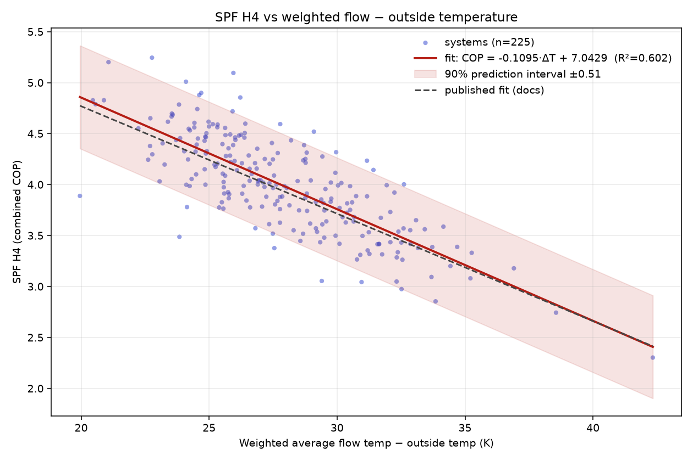
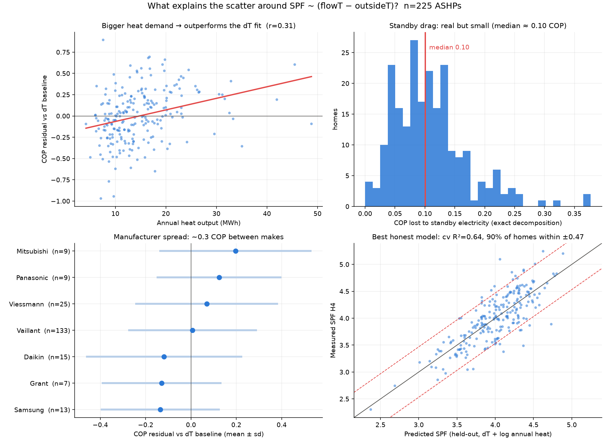
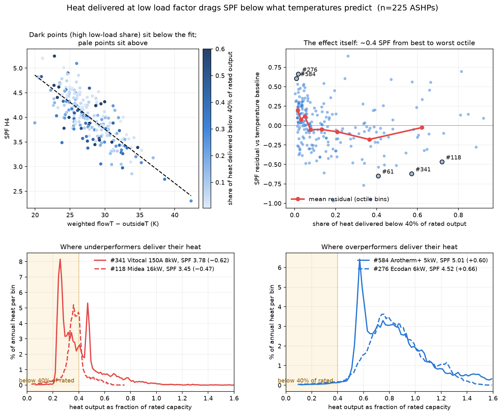
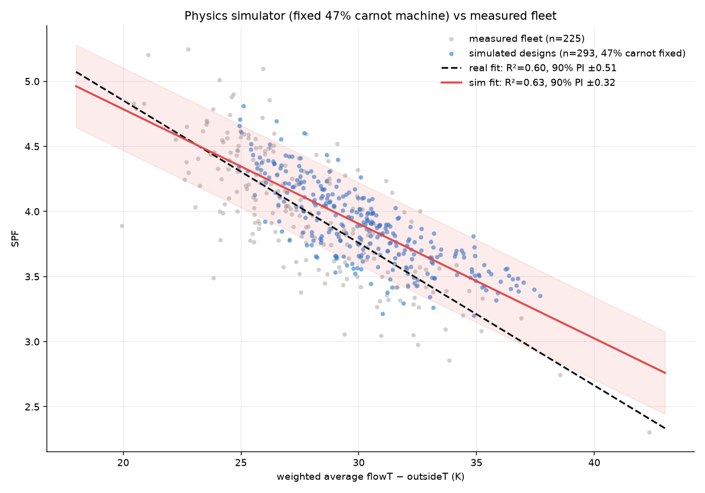
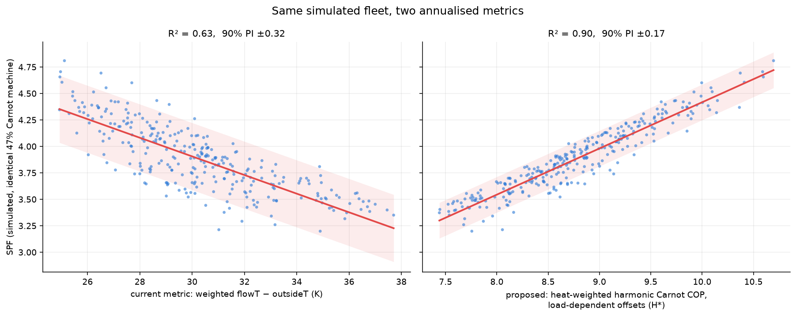

# Heat pump performance prediction

---

*Note from Trystan: This performance prediction project was largely generated using Claude code (Model: Fable - effort high).
Appart from this brief introduction the document text is all written by claude as will be clear!*

*This analysis attempts to progress my earlier manual analysis of the HeatpumpMonitor.org dataset as documented here: [https://docs.openenergymonitor.org/heatpumpmonitor/index.html](https://docs.openenergymonitor.org/heatpumpmonitor/index.html). I think it has uncovered a number of useful ideas!*

*The analysis also develops a harness for the dynamic heat pump simulator tool that I have been working on here: [https://openenergymonitor.org/tools/dynamic_heatpump](https://openenergymonitor.org/tools/dynamic_heatpump) and uses this to test and refine ideas that could then be applied to the real world data set. More work needs to be done to verify if these ideas work when applied to real data!*

*The following is work in progress and I welcome suggestions for improvement!*

---

How well can we predict a heat pump's seasonal performance (SPF H4) from
what we know about the system, and what is the scatter made of? The
starting point is the known relationship between SPF and weighted flow
temperature minus outside temperature (ΔT). The ambition was to get from
about ±0.5 SPF down towards ±0.1.

The short version: ΔT is still the best predictor we have. Nothing tried
here beat it by much on the real fleet, though several things we learned
along the way are useful in their own right.

**Data.** The HeatpumpMonitor.org all-fields export from 2026-07-15,
filtered to 225 air source, MID-metered, boundary H4 systems with at least
330 days of data and no cooling. Later work scanned the raw 10 s feeds for
229 systems. The dynamic_heatpump simulator was used as a testbed.

Other docs in this folder:

- [metering_floor.md](metering_floor.md): how accurate a measured SPF is
- [design_model.md](design_model.md): predicting SPF from the design sheet
- [load_and_quality.md](load_and_quality.md): the one open question, and
  the experiment planned to answer it

## Where things stand

All figures are 90% prediction intervals on held-out systems.

| Predictor | 90% PI | Notes |
|---|---|---|
| Weighted ΔT | ±0.51 | the baseline, R² 0.60 |
| ΔT + every safe published stat | ±0.45 | ceiling for the published table |
| ΔT + heat demand + low-load share | ±0.46 | best small model |
| H\* metric, real fleet | ±0.58 | worse than ΔT, not adopted |
| H\* metric, simulator | ±0.16 | didn't transfer to the fleet |
| Design sheet model, real fleet | ±0.74 | limited by the inputs |
| Design sheet model, simulator | ±0.21 | with truthful inputs |
| Metering error alone | ±0.10 | the floor |

## 1. The baseline still holds

The published fit was SPF = −0.105·ΔT + 6.88 (R² 0.55). On the current
data it comes out as **SPF = −0.110·ΔT + 7.04, R² 0.60, ±0.51**, so the
relationship has, if anything, got slightly stronger. Quadratic, log-log
and Carnot-of-the-mean forms were all tried and none beat the straight
line. The problem isn't the shape of the fit, it's how much a single
averaged ΔT can tell you.

Filter counts: boundary H4 gives 268 systems, air source 263, no cooling
228, ≥330 days 226, with both COP and ΔT present 225. The cooling filter
is the big cut. Without it the fit still holds (n = 258, R² 0.46).



## 2. What the published stats can add

Three ideas for the scatter were tested against the published per-system
stats.

**Standby electricity** is real and can be removed exactly, since
`combined_cop = running_cop / (1 + standby_elec / running_elec)`. It
costs a median 0.10 COP (worst case 0.38). Taking it out only lifts R²
from 0.60 to 0.63, though.

**Modulation** can't be seen in annual means. The mean load while running
correlates with the residual at only ρ = 0.19.

**Primary pipework losses** have no field in the data. The strongest
residual correlate is annual heat demand (ρ = 0.36: bigger homes beat the
line), but that's mixed up with standby and steadier running too, so it
can't be pinned on pipework.

Make matters a little. Mitsubishi averages about 0.2 above the line and
Samsung, Grant and Daikin about 0.13 below, but the scatter within each
make is large.

Throwing every safe field into a cross-validated model gets to cv R² 0.64,
±0.45. Gradient boosting did worse than linear regression (0.55): with
225 systems, a bigger model just overfits. The best small model is:

```
SPF = 6.93 − 0.115·ΔT + 0.117·(annual heat, MWh) − 1.63·(standby fraction of elec)
```

The prediction interval scales with √(1 − R²), so getting to ±0.25 would
need R² ≈ 0.90 and ±0.10 would need about 0.98. Better models won't get
there. We'd need better inputs.

**Leakage, a warning.** A first kitchen-sink model scored cv R² 0.85,
which was fake. If a model gets both heat-side and electricity-side
quantities it can reconstruct COP from their ratio. Keep them apart,
treat `prc_carnot`, `water_cop` and `running_cop` as restatements of the
target, and always score on held-out systems.



## 3. Systems that live at low load do worse

Power histograms from the heatpumpmonitor.org API (heat delivered at each
output power) gave the strongest single residual signal found anywhere in
this work: **the share of annual heat delivered below 40% of rated
output** (ρ = −0.33 with the ΔT residual). Systems that do a lot of their
work at low output underperform what their temperatures predict. This
isn't just small homes in disguise: controlling for annual demand still
leaves −0.28.

The typical system delivers only 10% of its heat below 40% of rated
output, but the top 15% deliver 40–72% there and sit about 0.23 COP below
the rest. It reads as oversizing showing up in operation. Below minimum
modulation the machine has to cycle, and fixed losses become a bigger
share. Adding it to ΔT and heat demand gives cv R² 0.65, ±0.46.

What this effect actually *is* is still open (see
[load_and_quality.md](load_and_quality.md)). The H\* work below showed
it can't be modelled as extra temperature lift.

Electricity-side histograms showed nothing useful. A one-dimensional annual
histogram mixes all weathers together, and most high-power running happens
in cold weather, which ΔT already accounts for.



The API endpoint, for reference (it needs a non-default User-Agent;
`Python-urllib` gets a 403):

```
https://heatpumpmonitor.org/histogram/kwh_at_power_heat?id=<id>&start=<t>&end=<t>&x_min=0&x_max=30000
```

## 4. The simulator: how much scatter does physics alone make?

A Node harness ran the unmodified dynamic_heatpump tool over 400
randomised house and system designs, all with the same machine (47% of
Carnot). After dropping designs that failed on comfort, 293 remained.
These results (`sim_results.csv`) came from the July 2026 version of the
simulator (tools repo commit `3c8d156`). The harness has since moved
upstream as `sweep.js` in the
[tools repo](https://github.com/openenergymonitor/tools); see the note at
the end of this section.

That synthetic fleet scatters **±0.32** around its own SPF ~ ΔT line, about
two thirds of the real fleet's ±0.51, with no variation in machines,
installs or metering. Its residual is almost entirely explained by how
well each design uses the machine (r = 0.97 with achieved % of Carnot),
driven by heat demand, capacity and DHW share, much like the real fleet.

At the time this suggested most of the real scatter was operating pattern
that ΔT throws away. The fleet test in section 5 showed that was too
optimistic. The simulator's designs span sizing and load far more widely
than real installs do, and its machines are identical by construction,
which real ones aren't. Treat the ±0.32 as the simulator's answer, not the
fleet's.



**Re-run on the current simulator (October 2026).** Since July the
simulator has gained frost and defrost, primary pipework losses and a new
cylinder model, and emitters are now sized from a design flow temperature.
A 400-scenario sweep with `sweep.js` (design flow temperature 35–55 °C,
other ranges as before) gives:

| SPF against | July sim | October sim |
|---|---|---|
| Weighted ΔT | R² 0.63, ±0.33 | R² 0.56, ±0.39 |
| Harmonic Carnot, fixed offsets | R² 0.64, ±0.32 | R² 0.57, ±0.38 |
| H\* | R² 0.90, ±0.16 | R² 0.70, ±0.32 |

H\*'s lead in the simulator is now much smaller. Several things changed at
once, so this doesn't say which change matters, but it fits the fleet
result in section 5: the July simulator flattered H\*. Only 243 of the 400
scenarios now pass the comfort filter (against 293), and the median DHW
share is 21%, above the fleet's 14%, so the scenario ranges could do with
re-tuning to the fleet.

## 5. H\*: a promising metric that didn't survive real data

Using the simulator as ground truth, we searched for a better annual
metric than ΔT. The winner was **H\***: an ideal Carnot COP averaged the
right way (heat-weighted harmonic mean, because electricity is the sum of
heat/COP), with the condensing and evaporating temperatures pushed apart
as the machine works harder:

```
r      = heat / rated capacity            (instantaneous load ratio)
Tcond  = flowT    + 3·r
Tevap  = outsideT − 8·r
carnot = (Tcond + 273.15) / (Tcond − Tevap)

H* = Σ heat / Σ (heat / carnot)           (running samples only)
```

It needs no electricity data, so it's an honest predictor rather than a
restatement of COP. In the simulator it took R² from 0.63 to 0.90 and
halved the interval to ±0.16.



On the real fleet it did worse than ΔT. `scripts/feed_scan/feed_scan_4.php`
computed H\* from the raw 10 s feeds for 229 validated air source systems:

| Metric (n = 229) | R² | 90% PI | Simulator said |
|---|---|---|---|
| Weighted ΔT | 0.60 | ±0.51 | 0.63 |
| Harmonic Carnot, fixed +2/−6 | 0.58 | ±0.53 | 0.64 |
| H\* (+3r/−8r) | 0.48 | ±0.58 | 0.90 |

To rule out the coefficients simply being wrong, `feed_scan_5.php`
exported a per-system histogram of heat by flowT, outsideT and load, so any
offsets could be tried offline. A search over 1,092 combinations (with
capacity taken either from the badge or from each system's own observed
peak) found that **the best load coefficient is zero**, and no member of
the family beats plain ΔT. That closes the metric search.

The interesting part is *why* it failed. It's covered in
[load_and_quality.md](load_and_quality.md).

A few useful side results:

- **The two pipelines agree.** The raw feed scan and the published weighted
  stats match to a few hundredths of a K for about 90% of systems. The 25
  that didn't match were almost all cooling systems: the published
  pipeline flips cooling heat positive and includes it, the scan leaves it
  out. A few others had very poor outside temperature data.
- **Badge capacity is a poor guide to the hardware.** Observed peak output
  is a median 1.33× the badge (IQR 1.09–1.67). A handful of 5 kW systems
  show 26–49 kW peaks, which must be heat-meter spikes and are worth a
  data QA pass.
- **Published % of Carnot reads slightly high and flatters oversized
  systems.** In the simulator, where every machine is identical, the fixed
  +2/−6 convention reads about 3 points high and up to about 5 points
  higher for low-load systems. In the fleet SPF/H\* has no less spread than
  the published score (sd 0.041 vs 0.037), so it isn't a fairer ranking.
  It does make the load effect visible, which the published score hides.
- **Ground source is out.** H\* uses outside air for the evaporator, which
  is wrong for a ground loop.

## 6. Ideas not yet tried

- **Daily records instead of annual ones.** The fleet is about 80,000
  system-days, not 225 data points. A pooled model of daily COP against
  daily conditions, with a per-system offset and held-out systems for
  testing, has far more to learn from. This is the most promising ML
  route. Success would be a held-out annual SPF interval near ±0.25.
- **Learn the residual, not the physics.** A small regularised model on
  top of the ΔT fit, with SHAP values to explain each system's gap.
- **Fit the simulator to individual homes.** The fitted % of Carnot would
  be a cleaned-up machine quality score, and whatever the fit can't
  explain points at unmodelled effects.
- **Metadata worth adding:** glycol concentration, primary pipework length,
  and the as-commissioned weather compensation curve (see
  [design_model.md](design_model.md)).
- **Publish a standby-corrected SPF.** It's an exact calculation.

## Files

Run the Python scripts from `analysis/performance_prediction/`. They pick
up the newest `heatpumpmonitor_all_fields_*.csv` automatically.

| Path | What it is |
|---|---|
| `analysis/hpmon_analysis.py` | loader, standard filter, linear fit with PI (section 1) |
| `analysis/residual_analysis.py`, `residual_plots.py` | residual tests and CV harness (section 2) |
| `analysis/fetch_histograms.py`, `modulation_analysis.py`, `lowload_plots.py` | histogram features (section 3); the fetch cache isn't kept |
| `analysis/sim_vs_real.py`, `metric_comparison.py`, `prc_carnot_offsets.py` | simulator comparisons (sections 4–5) |
| `analysis/design_model.py`, `design_model_plots.py` | design sheet model |
| `analyse_hstar_fleet.py`, `analyse_hstar_offsets.py` | H\* fleet test and offset search |
| tools repo, `www/tools/dynamic_heatpump/` | the simulator; `sweep.js` there runs the Monte Carlo sweep |
| `design_spf_tool/index.html` | interactive design sheet model |
| `heatpumpmonitor_all_fields_*.csv` | fleet export |
| `sim_results.csv` | July 2026 simulator sweep, used throughout these docs |
| `sim_results_2026-10.csv` | the October 2026 re-run on the current simulator (section 4) |
| `modulation_features.csv` | histogram features |
| `hstar_fleet.csv`, `hstar_fleet_hist.csv` | raw feed scan results, one row per system |
| `hstar_hist.csv` | per-system heat histograms, 113 MB, not in git; regenerate with `feed_scan_5.php` |
| `scripts/feed_scan/` (repo root) | the PHP feed scanners |
