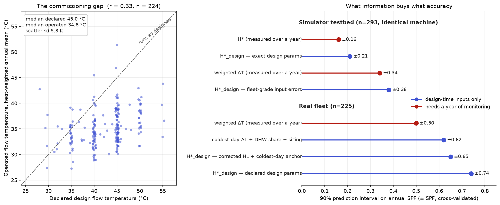

# Predicting SPF from the design sheet

ΔT and H\* both need a year of monitoring, so they're no help to a
designer. What a designer has is the design sheet: heat loss, design flow
temperature, emitters, DHW share. Can a simple model built from those
predict SPF before anything is installed?

**In principle yes, but only if the design sheet describes the system
that actually gets run, and in this fleet it mostly doesn't.**

The model is in `scripts/design_model.py`, and there's an interactive
version at `design_spf_tool/index.html`. The two agree to within 0.3%.

## How it works

No simulation and no monitoring data. The design parameters set the
weather compensation curve the system *should* run. A standard weather
year turns that into flow temperatures and loads through the season, and
from those we sum up an H\*-style ideal COP. For each half-hour at outside
temperature T:

```
Q        = U·(room − T) − gains − solar·aperture·0.9    space demand, smoothed over 24 h,
                                                         clipped to [0, capacity]
MWT      = room + 50·(Q / rad50)^(1/1.3)                 radiator equation
flowT    = MWT + system_ΔT / 2
r        = max(Q, min_mod·capacity) / capacity          load ratio
carnot   = (flowT + 3r + 273.15) / ((flowT + 3r) − (T − 8r))

H*_design = Σ heat / Σ (heat / carnot)                   plus a DHW block at its target temperature
SPF       ≈ η · H*_design
```

The 24-hour smoothing stands in for thermal mass. A midday solar surplus
can offset evening demand, and anything beyond that is thrown away.

The inputs are heat loss at a design temperature, room setpoint, emitter
capacity (or design flow temperature), system ΔT, rated capacity, DHW
share and target temperature, internal gains and solar aperture
(defaults 290 W and 4 m²), and a weather year with solar irradiance.
The only tuned constant is the minimum modulation ratio, 0.25, set by a
coarse search on the simulator.

The load terms (+3r/−8r) come from the simulator. The fleet test found
they carry no real signal beyond fixed offsets (see
[load_and_quality.md](load_and_quality.md)), so treat them as harmless
rather than meaningful.

### Defaults

The tool's defaults reproduce a median fleet system:

- 4.2 kW heat loss at −1.5 °C, with 120 + 240 W gains and 4 m² aperture,
  gives 13,035 kWh a year (fleet median 13,205 kWh).
- A 41 °C design flow temperature puts the curve through the fleet's
  median coldest day: 37.3 °C flow at −1.8 °C outside.
- 14% DHW and 6 kW capacity (the median capacity to heat loss ratio is
  1.4).
- η = 47%, a bench value without defrost, with defrost modelled
  separately (below).

Two of these aren't what you'd guess. 4.2 kW is below the median
*measured* heat loss of 5.1 kW (declared figures say 6.5 kW), which
reflects zoning and setback in real homes. And 41 °C is above what you'd
get by naively extrapolating from the coldest day (38 °C), because gains
cover about 360 W of the coldest-day load.

The default SPF (4.30) is above the fleet median (4.00). That's partly
because the ratio at median inputs isn't the median ratio, and partly the
tail of underperforming systems.

## In the simulator, with truthful inputs

On the simulator's 293 designs, where the design parameters are known
exactly:

| Predictor | Needs | cv R² | 90% PI |
|---|---|---|---|
| Weighted ΔT | a year of monitoring | 0.63 | ±0.34 |
| H\* | a year of monitoring | 0.90 | ±0.16 |
| **H\*_design** | **the design sheet** | **0.82** | **±0.21** |

The design sheet beats a year of measured ΔT. The cycling, setback and DHW
scheduling that the simulator models and this closed form ignores add up
to only about ±0.1. One thing does matter: modelling gains explicitly.
An early version that folded gains into a 1 K offset overestimated annual
space heat by 47% against the simulator and 2.3× against the fleet.

## On the real fleet

Same model, same method, 225 real systems:

| Predictor | cv R² | 90% PI |
|---|---|---|
| Weighted ΔT (a year of monitoring) | 0.59 | ±0.50 |
| H\*_design from declared parameters | 0.08 | ±0.74 |
| … with heat loss corrected | 0.06 | ±0.72 |
| … with the curve anchored on a measured coldest-day flowT | 0.13 | ±0.69 |
| … the same, leaving out the DHW block | 0.21 | ±0.65 |
| Coldest-day ΔT on its own | 0.42 | ±0.65 |
| Coldest-day ΔT + DHW share + capacity ratio | 0.42 | ±0.62 |

It falls apart, and the inputs are why:

- **Declared design flow temperature barely tracks reality (r = 0.33).**
  Declared median 45 °C, operated heat-weighted median 34.8 °C, with 5.3 K
  of scatter. Systems run about 10 K cooler than declared, and by very
  different amounts.
- **Declared heat loss runs about 24% high** (median ratio 0.76 across 134
  systems), though it does track measured heat loss well (r = 0.83), so it
  works once scaled down.

We can check that the inputs are the problem. Adding exactly these
errors (heat loss log-sd 0.26, flow temperature sd 5.3 K) to the
simulator's design sheets widens its interval from ±0.21 to ±0.38 and
drops R² from 0.82 to 0.47. A more detailed model would hit the same wall,
because it would be fed the same inputs.

It isn't just careless installers either. On the trained-installer subset
(Heat Geek / Heating Academy, n = 120) the model does a bit better (R²
0.19 vs 0.06), but the flow temperature gap is just as wide (r = 0.34 in
both groups). Declared design flow temperature seems to carry deliberate
headroom and later tuning as much as mistakes.

A useful middle ground: corrected heat loss plus one measured coldest-day
flow temperature predicts the operated annual flow temperature with
r = 0.73 (±2.4 K). The remaining 2.4 K is behaviour and weather the
design sheet can't know, and at −0.11 SPF per K that alone costs about
±0.3 SPF.

A single coldest day is a noisy measure of how a system runs. SPF falls
0.068 per K of coldest-day lift (flow − outside) against 0.109 per K of
weighted ΔT, a ratio of 0.63, and the two correlate at 0.82. So about a
third of the coldest-day figure is day-to-day noise.

### A plain regression instead

Skipping the physics and regressing SPF on coldest-day inputs does a bit
better (`scripts/regression_analysis.py`, n = 224):

| Model | cv R² | 90% PI |
|---|---|---|
| Coldest-day lift | 0.42 | ±0.65 |
| + log utilisation | 0.47 | ±0.60 |
| + DHW share | 0.48 | ±0.60 |
| + emitter type (UFH/radiators, new/old) | 0.50 | ±0.56 |

```
SPF ≈ 7.27 − 0.070·lift + 0.31·ln(utilisation) − 0.67·DHW share   (before emitter type)
```

Utilisation needs annual heat, which a designer only has as an estimate
(declared heat loss × 0.76 × degree-days). Emitter type helps here but
not on top of weighted ΔT (README section 2): old emitters mean higher
running temperatures than the coldest day shows, and weighted ΔT already
captures that. The same goes for DHW control type and DHW target
temperature. That makes them reasonable design-stage stand-ins for
operating temperature, but not separate effects. Declared design flow
temperature adds nothing at all (p = 0.92).



## Defrost

The simulator doesn't model defrost, so it was originally hidden inside
η. Two estimates from
[OEM forum thread 29547](https://community.openenergymonitor.org/t/what-scop-can-you-expect-from-a-system-that-runs-at-55c-and-50c-flow-temperatures-on-the-coldest-days/29547/18)
agree:

- Across the fleet, about 1.6% of net heat goes to defrost, about 0.15 SPF
  at SPF 4.
- One system measured COP 0.5–0.6 below its no-defrost trend over a cold,
  damp month. That annualises to 0.17–0.21 SPF.

The model now cuts COP by up to 13% in frosting conditions: full penalty
between −2 and +2 °C, fading to zero by +6 °C, and tapering in drier air
below −2 °C. That gives 0.16 SPF for the default system.

Two fleet checks back this up. With defrost included, the fleet's implied
η rises from 0.458 to 0.480, which matches bench values. And colder sites
do show slightly lower η (0.451 vs 0.466, about 0.13 SPF), though UK sites
are too similar in climate for this to separate systems much (r = 0.10).

## What to take from this

- If systems ran as designed, a design-sheet model would be nearly as good
  as a year of measured H\* in the simulator (±0.21 vs ±0.16), and a
  simple closed form is enough.
- On today's metadata it does worse than measured ΔT, because declared
  parameters describe intent, not operation.
- **The leverage is in commissioning data.** If we recorded the
  as-commissioned weather compensation curve, or even one measured
  coldest-day flow temperature, a design-time prediction of about ±0.2–0.3
  looks reachable. Treat declared design flow temperature as an upper
  bound.

Caveats: constants were tuned on the simulator, which shares the model's
functional form, so the simulator result is flattering. One weather year
(Llanberis 2024, shifted to each design temperature) stands in for local
climate, and postcode degree-days would be better. System ΔT is fixed at
5 K and room at 20 °C, and underfloor and fan coil emitters go through
the radiator equation.
