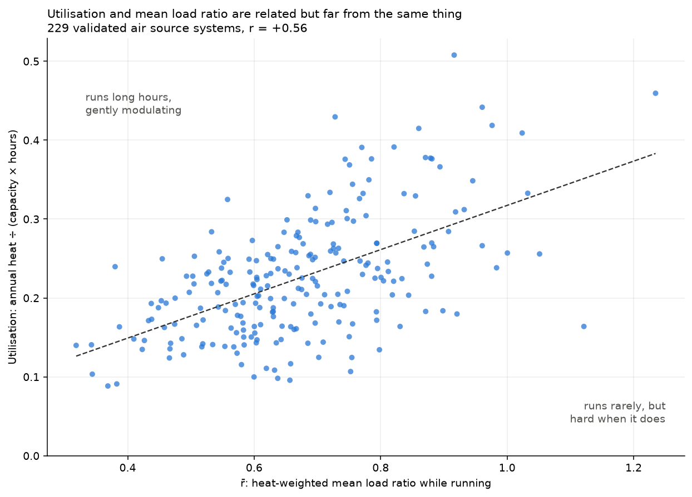
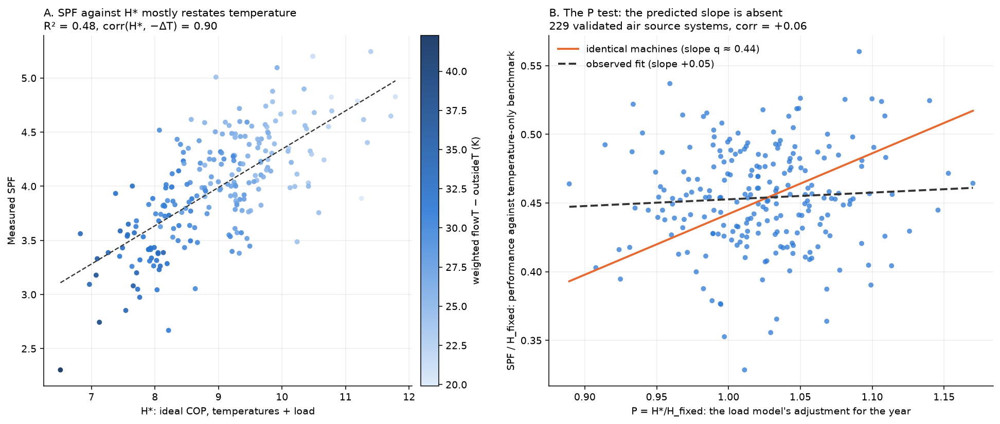
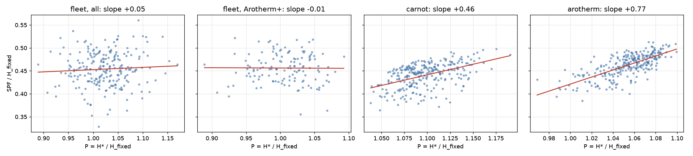
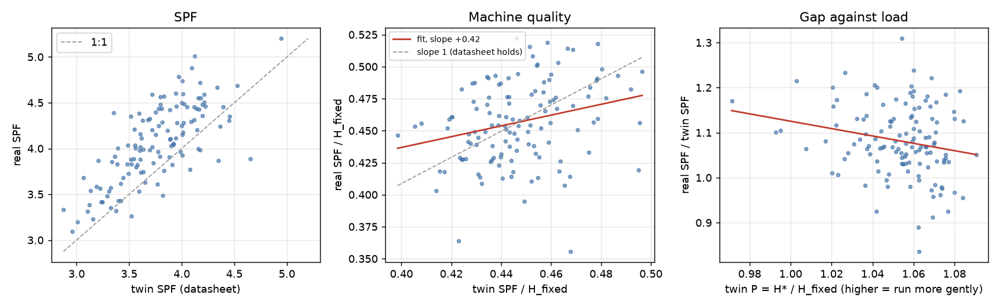

# The open question: why doesn't load show up in annual SPF?

*Status: open. The experiment at the end is planned but hasn't been run.*

Manufacturer data says a heat pump is much more efficient at low
compressor speed than flat out, at the same water and air temperatures.
The H\* metric (see [README.md](README.md), section 5) builds that in, and
on the real fleet it made prediction worse. This doc sets out what we know
about why, and how we could find out.

## Some definitions

These get mixed up easily, so to be precise:

- **r**: instantaneous load ratio, heat output divided by rated capacity.
- **r̄**: a system's heat-weighted annual mean of r. Fleet median 0.66,
  sd 0.15. (The *time*-weighted mean while running is lower: median 0.51,
  IQR 0.43–0.59.)
- **Utilisation**: annual heat divided by capacity × hours in the year,
  off-time included. Fleet median 0.22. It isn't used anywhere below.
  A system that rarely runs but goes flat out when it does has low
  utilisation and high r̄.
- **H_fixed**: heat-weighted harmonic Carnot COP with fixed +2/−6 K
  offsets. This only accounts for temperatures.
- **H\***: the same, with offsets that grow with load (+3r/−8r K).
- **P = H\*/H_fixed**: how much the load model adjusts each system's
  year. Above 1 means the heat was delivered gently, below 1 means the
  machine was run hard. Fleet sd 4.7%.

r̄ and utilisation are only loosely related (r ≈ +0.55). Both follow from
sizing, but at the same r̄ utilisation still ranges from 0.10 to 0.44
depending on climate, house and schedule.



## The test

If every machine achieved the same fraction q of its true ideal COP, then
SPF = q·H\*. Dividing both sides by H_fixed cancels the temperatures,
which are most of the signal, and leaves just the load part:

```
SPF / H_fixed = q · P
```

Plotted against P, systems should then line up along a slope of
q ≈ 0.45. Gently run systems should beat the temperature-only benchmark,
and hard-run ones fall short of it, by about 0.2 SPF per standard
deviation of P.

**The observed slope is +0.05. It's flat.** The over- and
under-performance the load model predicts isn't there.



*Panel A: SPF against H\* is dominated by temperature (colour = weighted
ΔT). Panel B: the load part on its own. The orange line is what identical
machines would show, and the fleet is flat.*

Other checks agree. Adding mean load ratio to ΔT doesn't help (cv R²
0.588 vs 0.595), and in a fit with both H_fixed and H\*, H\* gets a
coefficient of about zero.

## Two explanations

From annual data we can't tell these apart:

1. **The penalty is real but something cancels it.** Machines really are
   more efficient at low load, but systems run at low load are worse in
   some other way that roughly cancels the benefit.
2. **There's nothing to cancel.** The load model overstates how much the
   steady-state benefit is worth over a real year of operation, so flat
   simply means flat.

A simulator using the same load model as H\* can't decide between these,
since it would just give back what we put in. A simulator using a real
machine's datasheet can. That test is in the next section, and it rules
out the weakest form of explanation 2: the datasheet itself predicts a
large load effect.

### What's been ruled out as the cancelling effect

- **Standby.** It's small (median 2.4% of electricity), and using running
  COP instead of combined COP leaves the load slope unchanged. Whatever is
  going on happens while the compressor is running.
- **DHW share.** It's uncorrelated with SPF/H\* and barely changes with
  load.
- **Heat meter ΔT error.** Controlling for flow−return ΔT barely moves the
  load slope.

### What's still in the running

- **Efficiency drops off at minimum modulation.** The Arotherm data below
  shows COP turning over at the lowest speed. Systems at low r̄ spend more
  of their time down there.
- **Installation quality goes with sizing.** Well-sized systems may simply
  be better designed and commissioned in general.
- **The benefit doesn't hold up in real installs.** For example, part-load
  flow rates and water ΔT differ from the test conditions. This would be
  explanation 2.

## What the Arotherm datasheet predicts

The tools repo simulator now has a COP model fitted to the Vaillant
Arotherm+ datasheet (`generic_v2`: efficiency as a function of inferred
compressor speed, about 7% error against the tables). So we can simulate a
fleet of Arotherms and ask what the P test *should* show if real machines
behaved like their datasheet.

`sweep.js --cop-model generic_v2` ran 400 houses with Arotherm+ units: the
nearest badge size to the sampled sizing, maximum output and a 30 rps
minimum from the fit, flow rate sized for the badge output. The same 400
houses were also run with the old `carnot_variable` model for comparison.
About two thirds pass the comfort filter in each case. Then the same
tests were run on both sweeps and on the fleet
(`analysis/sim_model_comparison.py`):

| | n | P test slope | SPF ~ ΔT, cv R² | SPF ~ H\*, cv R² |
|---|---|---|---|---|
| Fleet, all | 229 | +0.05 ± 0.10 | 0.59 | 0.47 |
| **Fleet, Arotherm+ only** | **133** | **−0.01 ± 0.14** | 0.55 | 0.44 |
| Sim, carnot_variable | 272 | +0.46 | 0.61 | 0.72 |
| **Sim, Arotherm+ datasheet** | **267** | **+0.77** | 0.77 | 0.87 |

(± is the 95% interval on the slope.)



The datasheet predicts a *steeper* load effect than the carnot model, not
a flatter one. At the fleet Arotherms' own spread of P, a slope of 0.77 is
worth about 0.27 SPF per standard deviation, so a gently run Arotherm
should beat a hard-run one by around half an SPF at the same temperatures.
The 133 real Arotherms show nothing (−0.01 ± 0.14). Same hardware, same
test, and the datasheet prediction is far outside the fleet's interval.

The low-load share points the same way. In the carnot sim, systems with
more heat below 40% of rated output beat the ΔT line (ρ = +0.36), the
opposite of the fleet (ρ = −0.33). The Arotherm sim can't test this: its
minimum output is a fixed 25% of maximum, or 44% of badge, so almost no
heat is delivered below 40% of badge. Real units go lower in cold weather,
when the same 30 rps delivers less heat.

What this means:

- **The effect is in the datasheet.** "The load model overstates the
  part-load benefit" isn't the answer, at least not if real machines
  follow the datasheet.
- **So either real machines don't follow their datasheet at part load, or
  something cancels the benefit.** That's explanations 1 and 2 again, but
  sharper: the question is now specifically whether Arotherms in the field
  reach their datasheet COP at low speed.
- **The stable-episode experiment below answers exactly that,** and the
  133 validated Arotherms are the right population for it.

Caveats: the simulator's cycling below minimum output is simple, and real
starts and stops may cost more than it assumes. The sim's houses aren't
matched to the fleet: the fleet Arotherms run harder relative to their
badge (median P 1.01 against 1.06 in the sim). One weather year, and the
fit underpredicts the 5 kW unit by 10–16% at mild outside temperatures
(+10 to +20 °C).

## Twins of the real Arotherms

The houses in that sweep were random, so the next step was to simulate
each real Arotherm instead. `twins/twins.js` builds a twin for each of the
validated Arotherm+ systems with the same badge, room temperature, DHW
target, cylinder size and flow rate (from its running output and
flow−return ΔT), and the Llanberis weather shifted to its mean outside
temperature (median −2.5 K). It then calibrates heat loss, DHW volume and
design flow temperature until the twin matches the system's annual space
heat, water heat and heat-weighted flow temperature. 126 of 132 converged,
mostly within 3–5 simulated years. The calibrated heat losses (median
3.6 kW) sit close to the fleet's measured ones (4.0 kW).
`twins/compare_twins.py` then compares each system with its twin.



**The twins get the temperatures right but not the load.** Weighted
flow−outside ΔT correlates at 0.99 between real systems and their twins.
But the twins run more gently and more uniformly: median P 1.06 against
1.01, sd 0.020 against 0.038, correlation only 0.56. Running the twins'
hot water at full output instead of the app's 50% eco limit barely moved
this (1.062 to 1.058). So real systems deliver their space heating in a
harder, burstier way than a simulated house held at a constant setpoint
by smooth PI control. Schedules, setbacks, zoning and the real controls
aren't in the twins.

**Absolute SPF is close.** The twins come out 7.5% low (real/twin median
1.075), most of it in the 5 kW units (1.10), which matches the fit's known
10–16% under-prediction for that unit at mild temperatures. As an SPF
predictor the twins do no better than ΔT (cv R² 0.52 against 0.53).

**The P test, system by system:**

| | Slope | ± 95% |
|---|---|---|
| Twins: twin quality vs twin P | +0.36 | 0.16 |
| Real: real quality vs real P | −0.02 | 0.15 |
| Real quality vs twin P | −0.06 | 0.28 |

Matched to the fleet's own houses, the datasheet predicts a smaller load
effect than the random sweep did (+0.36 rather than +0.77). Applied to the
real spread of P, that's about 0.12 SPF per standard deviation, against
at most 0.04 allowed by the real data's interval. So the conclusion holds
in a weaker form: the datasheet's load benefit should be visible across
real Arotherms and isn't.

**Real quality does partly follow the twins.** Regressing real SPF/H_fixed
on the twin's gives a slope of +0.42 ± 0.28. The datasheet's other
variation in efficiency, mostly with temperature lift and flow
temperature, shows up in reality at about half size. It's the load part
specifically that's missing.

Nothing else stands out in the real/twin gap. Its strongest correlate is
badge size (−0.29: larger units fall further short of their datasheet),
then the twin's P (−0.21), heat loss per kW of badge (+0.17) and starts per
day (−0.16). DHW share and climate offset don't matter.

## How big a lever was it anyway?

Modest, if the datasheet held. P has an sd of 4.7% across the fleet.
Under the carnot model that's worth about ±0.19 SPF, and under the
Arotherm datasheet between ±0.12 (twins of real houses) and ±0.27
(random houses), against a fleet SPF sd of 0.49. In practice it's about
zero. Temperatures explain
about 0.60 of the variance and the rest is machine and install quality
plus noise.

The simulated fleets don't spread load more widely than the real one
(sd of P 0.024–0.035 in the sims, 0.047 in the fleet), so that isn't why
the simulator rated H\* so highly. It's that every simulated machine
follows its COP model exactly.

## The experiment: measure the compressor map in the field

The fleet has **150 Arotherm+ systems** in the clean scan (58 × 5 kW,
64 × 7 kW, 12 × 10 kW, 9 × 12 kW, 6 × 3.5 kW), and Vaillant publishes COP
per compressor speed. That's a ground truth we can check field data
against.

Arotherm 5 kW datasheet, 35/30 °C flow/return, COP (output kW):

| Outside | 120 rps | 90 rps | 70 rps | 50 rps | 40 rps | 30 rps |
|---|---|---|---|---|---|---|
| −7 °C | 2.7 (6.2) | 3.0 (4.5) | 2.9 (3.3) | 3.1 (2.2) | 3.4 (1.7) | — |
| +2 °C | 3.1 (7.3) | 3.4 (5.5) | 3.5 (4.2) | 3.7 (3.0) | 4.0 (2.4) | 3.9 (2.0) |
| +7 °C | 3.3 (8.0) | 3.7 (6.2) | 3.9 (4.9) | 4.3 (3.7) | 4.6 (2.9) | 4.1 (2.1) |

The part-load benefit is large (3.3 → 4.6 at +7 °C), at least as big as
the +3r/−8r model assumes. It turns over at 30 rps. And the "5 kW" badge
covers 2.1–8.0 kW of real output. Below 2.1 kW the machine has to cycle.

**The plan:**

1. Extend the stable-episode detector in `feed_scan_2.php` into a fleet
   extractor for the Arotherm systems. An episode is at least 10 minutes
   with the compressor on and flowT steady. Record mean COP, output,
   flowT, returnT, outsideT and flow rate for each.
2. Plot episode COP against output in bins of outside and flow
   temperature, and see whether field data reproduces the datasheet.
   Since flow temperatures rarely sit at exactly 35 °C, it's probably
   easier to plot COP / Carnot against output, which uses every episode.
3. For each system, weight its own episode curve by its annual histogram
   (from `hstar_hist.csv`) to get the SPF its steady running implies.
4. Compare that with its measured running SPF. The gap is everything
   steady running misses: cycling, defrost, DHW and transients. Then see
   whether the gap grows as r̄ falls.

**What the results would mean:**

- **Field curves match the datasheet:** explanation 1. The benefit is
  real, so the cancelling effect has to live outside steady running, and
  the step 4 gap should grow at low r̄ by around 0.2 SPF per sd of P.
  Spread between identical machines at the same operating point then
  measures install quality directly.
- **Field curves are flatter than the datasheet:** explanation 2. The
  benefit doesn't survive in real installs, and that by itself explains
  why H\* failed.
- **Low-load systems have few low-output episodes at all,** because they
  cycle instead of modulating. That would be informative in itself.

Practical notes:

- We don't have compressor speed in the feeds, so compare on output kW.
  Within one badge size that also sidesteps the capacity question.
- `feed_scan_2`'s stability thresholds (flowT sd < 0.01 K over 10 min,
  slope < 0.5 K/h, elec > 150 W) were tuned on one system and will
  probably need loosening. It's also worth requiring stable returnT, flow
  rate and outsideT.
- Separate out DHW episodes by flow temperature (over about 45 °C). They
  give a second, free comparison at DHW temperatures.
- Defrost recovery drops out by itself, since flowT isn't stable.

---

*Files: `scripts/feed_scan/feed_scan_2.php` (episode detector),
`feed_scan_4.php` (fleet H\* scan), `feed_scan_5.php` (histograms);
`analyse_hstar_fleet.py`, `analyse_hstar_offsets.py`; `hstar_fleet.csv`,
`hstar_fleet_hist.csv`, `hstar_hist.csv`.*
