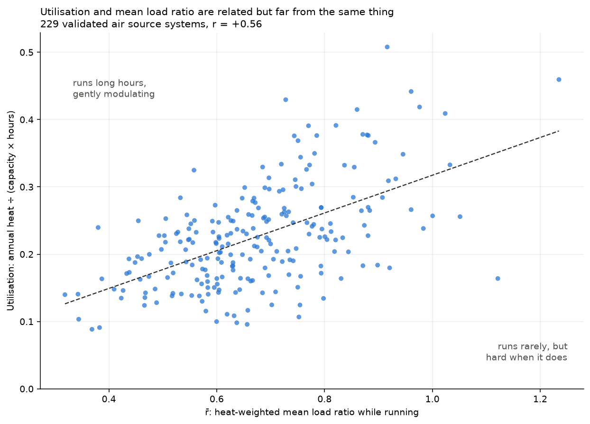
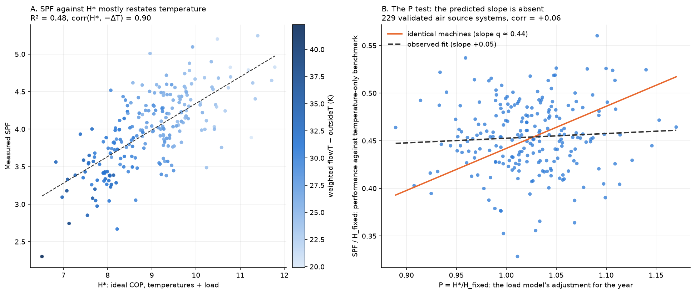
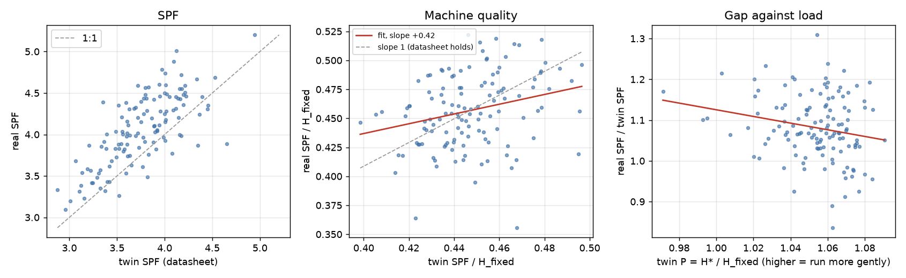

# Why doesn't load show up in annual SPF?

*Lab notes. Ongoing, last updated 2026-11-19. Conclusions are provisional.*

Manufacturer data says a heat pump is much more efficient at low compressor
speed than flat out, at the same water and air temperatures. The H\* metric
(see [README.md](README.md), section 4) builds this in. On the real fleet
it doesn't improve SPF prediction. These notes cover what we've found so far
and what to try next.

## Terms

- **r**: instantaneous load ratio, heat output divided by rated capacity.
- **r̄**: a system's heat-weighted annual mean of r. Fleet median 0.66,
  sd 0.15.
- **Utilisation**: annual heat divided by capacity × hours in the year.
  Fleet median 0.22. Only loosely related to r̄ (r ≈ 0.55).
- **H_fixed**: heat-weighted harmonic Carnot COP with fixed +2/−6 K
  offsets. Temperatures only.
- **H\***: the same, with offsets that grow with load (+3r/−8r K).
- **P = H\*/H_fixed**: the load adjustment on its own. Above 1 means the
  heat was delivered gently. Fleet sd 4.7%.



## How it was computed

- **From 10s data.** `hstar_fleet.php` and `hstar_hist_fleet.php` scan the
  last 365 days of raw 10s feeds for each system. Every sample is used if
  elec, heat, flowT, returnT and outsideT are all present and heat > 0.
  The scan builds up H\*, H_fixed, weighted temperatures and SPF, plus a
  heat-weighted histogram of (flowT, outsideT, r).
- **No steady-state selection.** Start-ups, cycle tails, pump overrun,
  defrost recovery and DHW are all included. See explanation 3 below.
- **Then compared across systems.** The tests below use one annual point
  per system. They ask whether systems with a gentler year get a better
  year, not whether low-output running is more efficient within a system.

## Finding 1: the P test is flat

If every machine achieved the same fraction q of its ideal COP, then
SPF/H_fixed = q·P, and the fleet should line up on a slope of about 0.45.
**The observed slope is +0.05.**



Other checks agree:
- Adding r̄ to ΔT doesn't help (cv R² 0.59 either way).
- Fitted together with H_fixed, H\* gets a coefficient of about zero.

## Finding 2: datasheet twins of real Arotherms do show the effect

`twins/twins.js` builds a simulated twin of each of the 132 validated
Arotherm+ systems. Each twin uses the `generic_v2` datasheet COP fit
(about 7% error against the Vaillant tables), with heat loss, DHW volume
and design flowT calibrated to the real system's annual space heat, DHW
heat and weighted flowT. 126 converged.



| | Slope | ± 95% |
|---|---|---|
| Twins: twin quality vs twin P | +0.36 | 0.16 |
| Real: real quality vs real P | −0.02 | 0.15 |
| Real quality vs twin P | −0.06 | 0.28 |

- **The datasheet predicts a load effect in these houses**, about 0.12
  SPF per sd of P, and the real systems don't show it. So it's probably
  not just that our load model overstates the benefit.
- **Only the load part seems to be missing.** Real SPF/H_fixed follows the
  twins' non-load variation (lift, flowT) at about half size (slope +0.42
  ± 0.28).
- **Real systems run harder and burstier than their twins.** They match on
  temperature (weighted ΔT correlation 0.99), but median P is 1.01
  against 1.06, sd 0.038 against 0.020, and P correlates only 0.56. The
  twins have no schedules, setbacks, zoning or real controls.
- **Absolute SPF:** the twins come out about 7.5% low, mostly in the 5 kW
  units, where the fit is known to under-predict.
- **The real/twin gap** correlates weakly with badge size (−0.29), twin P
  (−0.21) and starts per day (−0.16).

Caveats: the simulator's cycling is simple and probably understates start
and stop losses. One weather year, shifted rather than local.

## Ruled out (so far)

- **Standby.** It's small (2.4% of electricity), and using running COP
  leaves the slope unchanged.
- **DHW share.** It's uncorrelated with SPF/H\*.
- **Heat meter ΔT error.** Controlling for flow−return ΔT barely moves the
  slope.

## Candidate explanations

1. **The benefit is real but something cancels it.** Possibly COP turning
   over at minimum modulation, with low-r̄ systems spending more time
   there or cycling. Or install quality that goes with sizing.
2. **Real machines don't reach their datasheet COP at part load.** For
   example, part-load flow rates and ΔT may differ from test conditions.
3. **The metric is contaminated by transients.** The datasheet tables are
   steady state, but H\* applies them to every 10s sample. Start-ups,
   cycle tails, pump overrun and defrost recovery all have low
   instantaneous r. H\* scores them as gentle, efficient running, when in
   reality they're some of the least efficient moments. Heat-meter lag
   adds further noise. This would push P up for systems with a lot of
   starts while their SPF goes down, which flattens the slope. It
   overlaps with 1: cycling losses are real physics, and P also
   misattributes them. We don't yet know what share of annual heat falls
   in transients, so we can't say how much this explains.

These can't be separated using annual cross-system data.

## How big a lever is it?

Probably modest even if the datasheet held. One sd of P is worth about
0.12 SPF under the Arotherm datasheet and 0.19 under the Carnot model,
against a fleet SPF sd of 0.49. Temperatures explain about 60% of
variance. The simulator rated H\* highly because simulated machines follow
their COP model exactly. Simulated load actually varies less than real
load, so that isn't the reason.

## Next steps

1. **Steady-only P.** Recompute P from steady-episode samples only (or
   drop the first N minutes after each start) and rerun the P test. Also
   measure the share of annual heat that falls in transients. *Tests
   explanation 3.*
2. **Field compressor map.** Use `steady_episodes_fleet.php` on the
   Arotherms: episodes of at least 10 minutes with the compressor on and
   flowT steady. Plot episode COP (or COP/Carnot) against output kW, in
   outsideT and flowT bins, and compare with the datasheet. *Tests
   explanation 2.*
3. **Steady vs actual SPF.** Weight each system's episode curve by its
   annual histogram (`hstar_hist.csv`) to get the SPF its steady running
   implies, and compare that with measured running SPF. Does the gap grow
   as r̄ falls? *Tests explanation 1.*

How we'd read the results:
- **Field curves match the datasheet:** the benefit is real at steady state
  and is lost somewhere outside steady running.
- **Field curves are flatter than the datasheet:** the benefit doesn't
  survive in real installs.
- **Low-r̄ systems have few low-output episodes:** they cycle rather than
  modulate. That would be informative in itself.

Ground truth, Arotherm 5 kW datasheet at 35/30 °C, COP (output kW):

| Outside | 120 rps | 90 rps | 70 rps | 50 rps | 40 rps | 30 rps |
|---|---|---|---|---|---|---|
| −7 °C | 2.7 (6.2) | 3.0 (4.5) | 2.9 (3.3) | 3.1 (2.2) | 3.4 (1.7) | — |
| +2 °C | 3.1 (7.3) | 3.4 (5.5) | 3.5 (4.2) | 3.7 (3.0) | 4.0 (2.4) | 3.9 (2.0) |
| +7 °C | 3.3 (8.0) | 3.7 (6.2) | 3.9 (4.9) | 4.3 (3.7) | 4.6 (2.9) | 4.1 (2.1) |

The part-load benefit is large (3.3 → 4.6 at +7 °C) and turns over at
30 rps. Below about 2.1 kW the machine has to cycle.

Practical notes:
- Compressor speed isn't in the feeds, so compare on output kW within a
  badge size.
- The episode thresholds were tuned on one system and will probably need
  loosening. Also require stable returnT, flow rate and outsideT.
- Split out DHW episodes (flowT above about 45 °C) as a second comparison.

## Population

132 validated Arotherm+ systems (55 × 5 kW, 56 × 7 kW, 11 × 10 kW,
7 × 12 kW, 3 × 3.5 kW), from 150 scanned. One 24 kW entry is excluded
from the twins.

---

## Scripts

Run from `analysis/performance_prediction/` with the `.venv` python,
except where noted.

- **Fleet scans** (`scripts/feed_scan/` at the repo root):
  `hstar_fleet.php` → `hstar_fleet.csv`; `hstar_hist_fleet.php` →
  `hstar_fleet_hist.csv` and `hstar_hist.csv` (113 MB, not in git);
  `steady_episodes_fleet.php` → `signature_episodes`.
- **P test:** `scripts/analyse_hstar_fleet.py`,
  `scripts/analyse_hstar_offsets.py`. `scripts/hstar_plots.py` draws the
  P test and utilisation figures (needs `hstar_hist.csv`).
- **Twins** (`twins.js` needs tools repo commit `176ae57` or later):

  ```
  .venv/bin/python twins/twin_targets.py > twins/targets.json
  node twins/twins.js --tools <tools repo>/www/tools/dynamic_heatpump
  .venv/bin/python twins/compare_twins.py --fig docs/figures/twins.png
  ```
